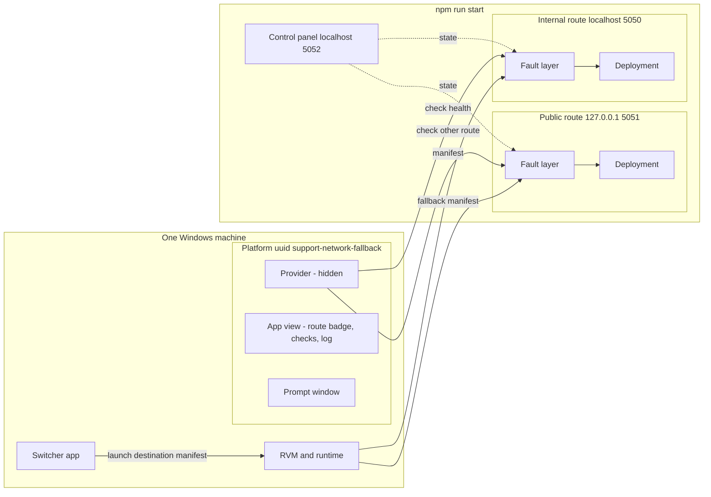
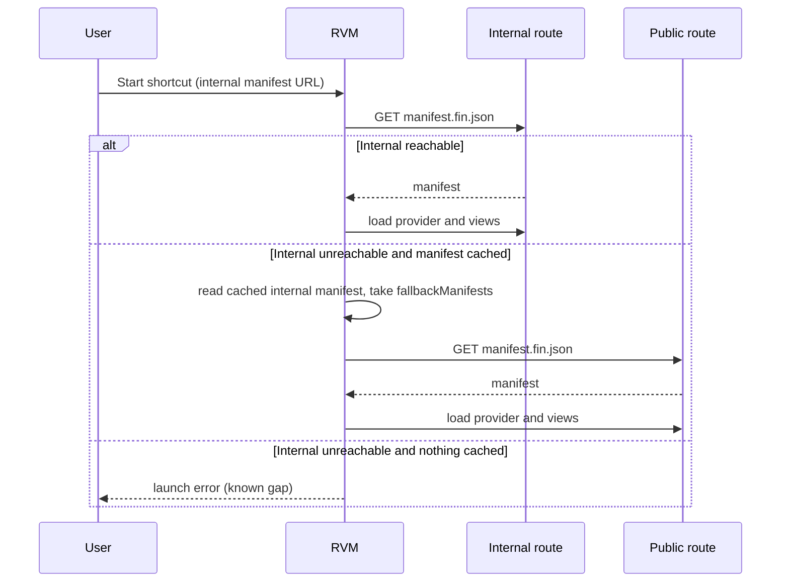
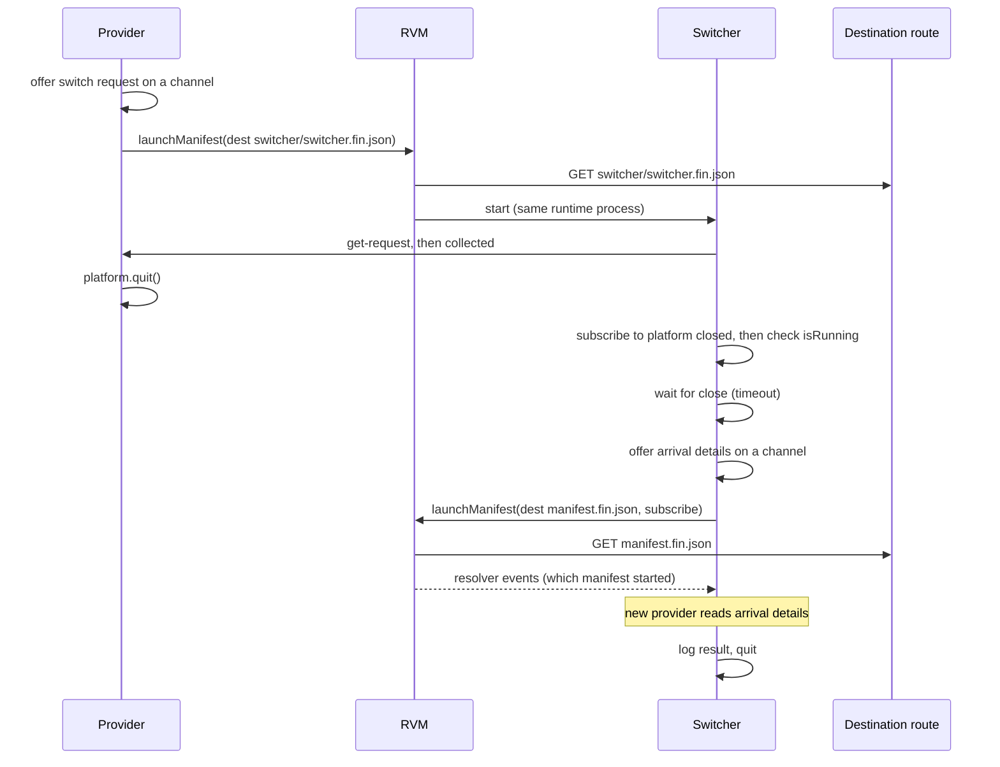

# Support network fallback

## What this shows

Some customers run the same HERE Core Container platform as two deployments: an internal deployment that users should prefer, and a public deployment to use when the internal one is not available. This guide calls each deployment a route. Each route has its own manifest URL, so today each user needs two shortcuts and has to know which one to use. When the internal route is unavailable, the user has to notice, close the platform, and start it again from the other shortcut.

This starter answers one question: **can one shortcut prefer the internal route, use the public route when it has to, and move between the two while running?**

The short answer:

- **At launch, yes, with prerequisites.** The RVM honours a `fallbackManifests` list in the manifest. It can only read that list from a cached copy of the manifest, so the manifest needs `offlineAccess` and must have launched successfully at least once on the machine. It only moves on to the fallback when the internal route refuses the connection; an HTTP error, a sign-in page or a route that hangs does not trigger it. See [Observed results](#observed-results).
- **While running, only with application code.** There is no API that tells the RVM to close one manifest and start another. This sample adds a health check, a prompt and a small switcher app to do it.
- **A first-ever launch while the internal route is unavailable does not fall back.** Nothing is cached yet. See [Known gaps](#known-gaps).

The starter has three parts: this guide and [the scenarios document](./docs/scenarios.md), a running sample that simulates both routes on one machine, and a control panel that puts either route into one of four states so you can try each scenario before changing your own platform.

The examples use `app.example.internal` for the internal route and `app.example.com` for the public route.

## This is an example, not production code

This is an example of how to use HERE manifests to configure HERE Core Container. Its purpose is to provide an example and suggestions. **DO NOT** assume that it contains production-ready code. Please use this as a guide and provide feedback. Thanks!

In particular, the health check is deliberately bare. It exists to show the pattern and drive the simulator, not as an ideal health check. [Production hardening](#production-hardening) lists what a real deployment should add.

## Quick start

These steps assume you are in this folder (`how-to/use-a-manifest/support-network-fallback`) on Windows. Launch fallback is handled by the RVM, which is Windows only.

1. Install dependencies and do the initial build.

   ```shell
   npm run setup
   ```

2. Build the client bundles and the server.

   ```shell
   npm run build
   ```

3. Start the two route servers and the control panel in a new terminal. Leave it running.

   ```shell
   npm run start
   ```

4. Open the control panel at [http://localhost:5052](http://localhost:5052).

5. Launch the platform from the internal route. This first launch caches the internal manifest and creates the Start menu shortcut.

   ```shell
   npm run client
   ```

   `npm run client:public` launches from the public route instead.

6. Close everything when you are done.

   ```shell
   npm run kill
   ```

**The fresh identity.** One scenario needs a manifest the RVM has never cached. For that scenario only, set the internal route to `down` in the control panel and then run:

```shell
npm run client:fresh
```

> **Launch only with the internal route down. A successful launch caches this identity.** If it gets cached, follow [Resetting the fresh identity](#resetting-the-fresh-identity-and-removing-the-sample).

The [scenarios document](./docs/scenarios.md) walks through each scenario: what to set in the control panel, what to launch, what you should see and which log lines to expect.

## Pieces and ports

One Node process (`npm run start`) runs three HTTP servers. Two stand in for the real deployments and one is the test-only control panel. The two routes use different host names (`localhost` and `127.0.0.1`), so their cookies, storage and CORS behave like two separate origins.

| Piece          | Local address           | Stands in for                  | Role                                              |
| -------------- | ----------------------- | ------------------------------ | ------------------------------------------------- |
| Internal route | `http://localhost:5050` | `https://app.example.internal` | Preferred deployment                              |
| Public route   | `http://127.0.0.1:5051` | `https://app.example.com`      | Fallback deployment                               |
| Control panel  | `http://localhost:5052` | nothing (test only)            | Sets each route's state, shows `/health` requests |

Each route server serves:

- `/manifest.fin.json`, the platform manifest for that route;
- `/fresh/manifest.fin.json`, the same manifest under the fresh identity, used only for the first-launch scenario;
- `/health`, the health document;
- `/provider.html` and `/app.html`, plus the bundles under `/js`;
- `/switcher/`, the switcher app: `switcher.fin.json` (with the route's origin filled in), `switcher.html` and `switcher.css`.

The control panel puts each route into one of four states:

| State          | What the route does                               |
| -------------- | ------------------------------------------------- |
| `healthy`      | Serves everything; `/health` reports `healthy`    |
| `unhealthy`    | Serves everything; `/health` reports `unhealthy`  |
| `server-error` | Answers every request with HTTP 500               |
| `down`         | Refuses connections, as an unreachable host would |

The control panel also has three provider-only states, used only to find out which provider failures make the RVM fall back at launch: `provider-500`, `provider-reset` and `provider-refused`. In each of them the manifest and `/health` keep working; see [When the manifest is served but the provider fails](#when-the-manifest-is-served-but-the-provider-fails).

The simulator wraps each route server in a fault layer that the control panel controls. The deployment code never imports the simulator; [server/src/index.ts](./server/src/index.ts) is the only file that joins them.



## Part 1: Preferred and Fallback

### The manifests

The platform manifests are generated by [server/src/deployment/manifests.ts](./server/src/deployment/manifests.ts) from one shared config, [shared/route-config.ts](./shared/route-config.ts). That config holds the runtime version (`43.142.101.2`), the runtime arguments (`--v=1 --inspect --enable-mesh --security-realm=support-network-fallback`), the platform uuid and the license key. Defining them once means the two routes cannot drift apart. The switcher manifest is a file, [public/switcher/switcher.fin.json](./public/switcher/switcher.fin.json), which repeats the runtime version and arguments; see [The switcher](#the-switcher).

| Manifest | URL                                       | Points provider and view at | `fallbackManifests`         | `shortcut` block              |
| -------- | ----------------------------------------- | --------------------------- | --------------------------- | ----------------------------- |
| Internal | `http://localhost:5050/manifest.fin.json` | internal route              | public manifest             | yes, `target: ["start-menu"]` |
| Public   | `http://127.0.0.1:5051/manifest.fin.json` | public route                | internal manifest           | no                            |
| Fresh    | `<route>/fresh/manifest.fin.json`         | its own route               | the other route's `/fresh/` | no                            |
| Switcher | `<route>/switcher/switcher.fin.json`      | its own route               | none                        | no                            |

Both platform manifests have `offlineAccess: true`, the same platform uuid, the same runtime version and the same security realm.



### The shortcut

The internal manifest's `shortcut` block has `target: ["start-menu"]`, so when the internal manifest launches the RVM creates a "Support Network Fallback" Start menu shortcut in an "Example Co" folder, pointing at the internal manifest URL, together with an "Uninstall Support Network Fallback" entry. No desktop shortcut is created. There is no shortcut code in the platform.

This fits the cache prerequisite: the launch that creates the shortcut is a successful launch of the internal manifest, so it has also cached the manifest that launch fallback needs next time. The public manifest has no `shortcut` block, so a launch from the public route creates nothing and the shortcut never points at the public manifest. The RVM rewrites the shortcut each time it starts the internal manifest, including from the cached copy at the start of a fallback, but always with the internal manifest URL.

The RVM remembers shortcut choices made through the API: `Application.setShortcuts` stores them per app under `HKCU\Software\OpenFin\RVM\AppSettings`, and they then override the manifest. If something has turned the Start menu shortcut off for the internal manifest that way, the `shortcut` block no longer creates it until that registry value is removed.

In a real deployment an MSI may own the shortcut instead. If it does, the first launch still has to succeed on the internal route before fallback works; see [Known gaps](#known-gaps).

### Why each route hosts its own provider

With a platform, the RVM is starting the provider. On Windows the RVM moved to the fallback list only when the runtime reported that the provider window failed to load (`Failed to load URL in the app's main window`, `ERR_CONNECTION_REFUSED`). Putting `platform.providerUrl` on the route's own origin means "this route is unreachable" equals "the provider fails to load", which is the failure that starts the fallback.

The failure has to be at the network level. When the provider URL returned HTTP 404 or 500, the RVM reported a successful launch and did not fall back: the platform was running, but its provider never ran, so nothing appeared. A view that fails to load does not trigger fallback either, because the platform has already started.

So in your own deployment, host your provider on each route, as this sample does, and make an unavailable internal route fail at the network level (for example, an internal host name that does not resolve outside the internal network) rather than answer with an error page.

This rule is also why the provider can tell which route it is on: its own `location.origin` is the current route.

### When the manifest is served but the provider fails

The internal host can be up and serving the manifest while the provider is broken, for example because the services behind it are failing. What decides the fallback is how the provider page fails, not whether the manifest was served. With a cached internal manifest and the manifest still served, the provider-only states gave these results:

| Provider failure                                                     | Fell back? | What the RVM did                                                                                                                        |
| -------------------------------------------------------------------- | ---------- | --------------------------------------------------------------------------------------------------------------------------------------- |
| `provider-refused`: `providerUrl` points at a port with no listener  | Yes        | Used the live manifest, reported `Failed to load URL in the app's main window` after about 10 seconds, then started the public manifest |
| `provider-reset`: the server closes the connection without answering | Yes        | The same, but the provider load failed within 2 seconds; the platform was on the public route 9 seconds after launch                    |
| `provider-500`: the provider page returns HTTP 500                   | No         | Reported `Result of loading primary application: Success` and left a platform running with no window                                    |

So to make a broken provider trigger the fallback, it must fail as a connection, not as an HTTP response. Two ways to do that in a real deployment:

- **Close the connection instead of sending an error page.** When the provider or the services behind it are unhealthy, have the web server or proxy drop the request without a response. With nginx, for example, `return 444` closes the connection; in the provider page's `location`, `proxy_intercept_errors on;` with `error_page 500 502 503 504 = @drop;` and a `location @drop { return 444; }` turns upstream errors into that (untested here). This is what `provider-reset` simulates. Keep the rule to the provider page: an HTML error page elsewhere is still useful to users.
- **Give the provider its own host name, and take it away when unhealthy.** Serve `providerUrl` from a host such as `provider.app.example.internal` and use a health-checked DNS record or load balancer listener, so that host refuses or fails to resolve when the provider is unhealthy, while the manifest host stays up. This is close to `provider-refused`. DNS changes are only as fast as the record's time to live.

The alternative is to handle it in your own code: serve the provider as a small page that is always available, check what it depends on before calling `fin.Platform.init()`, and if something is broken, launch the public manifest and quit, as the switcher does. That does not depend on which load errors the RVM counts, but you write and maintain it yourself.

### The cache prerequisite

The RVM reads `fallbackManifests` from the manifest it was asked to start. If the internal route cannot be reached, the only copy available is the cached one, and a manifest is only cached when it has `offlineAccess: true` and has launched successfully before on that machine. Without a cached copy, the RVM has no fallback list to use and the launch fails.

### Observed results

These results were recorded on Windows with RVM `20.0.1.4`, runtime `43.142.101.2` and `@openfin/core` `43.101.2`. The per-scenario results are in [the scenarios document](./docs/scenarios.md).

- **Launch fallback works once the manifest is cached.** The RVM used `fallbackManifests` only when the manifest had `offlineAccess: true` and had launched successfully at least once, so a cached copy existed to read the list from.
- **Only a network-level failure falls back.** With the internal route refusing connections, the RVM used the cached manifest, the provider failed to load, and the RVM then started the public manifest. With the manifest still served, a provider whose connection was refused or closed without an answer also led to a fallback; see [When the manifest is served but the provider fails](#when-the-manifest-is-served-but-the-provider-fails). When the internal route answered with HTTP 404, with a provider returning 500, or with a sign-in page, it did not fall back. When the internal route accepted connections and never answered, it did not fall back either; see [Known gaps](#known-gaps).
- **Fallback is slow on Windows.** A refused connection to a local port takes about 2 seconds on Windows, and the RVM tries the manifest twice, so the platform appeared 18 to 26 seconds after launch when the internal route was down.
- **There is no API for the running case.** Nothing tells the RVM to close one manifest and start another, which is why Part 2 exists.
- **`launchManifest` arguments do not reach a newly started app.** `userAppConfigArgs` passed to `fin.System.launchManifest` were not visible in the started app's `initialOptions`, `fin.desktop.main` or URL. The switch therefore hands its details over the InterApplicationBus; see [The switch](#the-switch).
- **`fin://` links over plain HTTP are blocked.** The RVM refused the sample's `fin://` links with `FinProtocolInstallationBlocked`, because it requires `fins://` over HTTPS for links. `npm run client` therefore starts the RVM directly, as a shortcut does.

| Check                                                                                        | Result                                                                                                                                            |
| -------------------------------------------------------------------------------------------- | ------------------------------------------------------------------------------------------------------------------------------------------------- |
| `getManifest()` returns the public manifest, including `fallbackManifests`, after a fallback | Yes                                                                                                                                               |
| A failed launch of the fresh identity, with the internal route down, leaves nothing cached   | Yes, no folders were created                                                                                                                      |
| The folders under `%LOCALAPPDATA%\OpenFin` that belong to the sample                         | One `apps` folder per manifest URL, plus `cache\support-network-fallback`; see [Resetting](#resetting-the-fresh-identity-and-removing-the-sample) |
| A sign-in page returning HTTP 200 for the manifest URL still lets launch fallback happen     | No, the RVM failed with `FailedToReadAppConfig`                                                                                                   |
| The provider can open an `about:blank` child window and write the prompt into it             | Yes                                                                                                                                               |
| The runtime accepts a relative `startup_app.url`, resolved against the manifest URL          | No, it logged `Invalid URL supplied: switcher.html` and the window never opened                                                                   |
| `shortcut.target: ["start-menu"]` creates only a Start menu shortcut                         | Yes, plus an "Uninstall" Start menu entry                                                                                                         |

### Why `npm run client` does not use the node adapter

A shortcut starts the RVM with a manifest URL, and the RVM fetches the manifest itself. That is the only path on which the RVM can use its cached copy and fallback list.

[scripts/launch.mjs](./scripts/launch.mjs) does the same. On Windows it runs `%LOCALAPPDATA%\OpenFin\OpenFinRVM.exe --config=<manifest URL>`, which is what the Start menu shortcut runs. On other systems it opens the `fin://` link with `open`. It does not use the node adapter, because the node adapter fetches the manifest before the RVM starts, so it fails as soon as the route is unreachable and the RVM never gets the chance to fall back.

The control panel shows the same RVM commands and `fin://` links. The RVM blocks `fin://` links to manifests served over plain HTTP, so on Windows use the RVM command; see [Moving to real hosts](#moving-to-real-hosts).

## Part 2: Health check and Switch

### What counts as healthy is your decision

Each route's `/health` endpoint returns `{ "status": "healthy" }` or `{ "status": "unhealthy" }`. What makes a route healthy is for the platform owner to decide: for example, whether the services the app depends on behind that route are working, not just whether the web server answers. This sample does not try to make that decision. Its `/health` reports whatever the control panel has set. The handler is in [server/src/deployment/health.ts](./server/src/deployment/health.ts) and the contract in [shared/health-contract.ts](./shared/health-contract.ts).

### The loop

The provider runs a deliberately bare loop, in [client/src/health-check.ts](./client/src/health-check.ts):

1. **Check** the current route's `/health` every 5 seconds, with a 2-second timeout.
2. If it is healthy, do nothing more.
3. If it is not, **check** the other route's `/health`.
4. If the other route is healthy, **ask** the user whether to switch.
5. If they accept, **switch** by restarting the platform from the other route.

A check counts as healthy only for an HTTP 200 JSON response with `status` `healthy`. A refused connection, a timeout, an HTTP error or a response that is not that JSON (for example a sign-in page) all count as unhealthy.

The other route is checked only while the current route is unhealthy, so a healthy platform never sends requests to the other route. While the prompt is open or a switch is starting, the loop does no checks. There is no backoff, no jitter and no snooze: if the user says "Not now" and the routes have not changed, the next check offers the switch again. [Production hardening](#production-hardening) describes what a real deployment should add.

The interval and timeout are `HEALTH_POLL_INTERVAL_MS` and `HEALTH_TIMEOUT_MS` in [shared/route-config.ts](./shared/route-config.ts). The "Switch to other route" button in the app view goes straight to the prompt, without checking either route, so you can try a switch without breaking anything.

[client/src/provider.ts](./client/src/provider.ts) wires the loop to the prompt and the switch, and sends the last checks and the log to the app view.

### The prompt

[client/src/prompt.ts](./client/src/prompt.ts) exposes one function:

```text
askUser(offer: { reason, fromDisplayHost, toDisplayHost }) -> Promise<"accept" | "decline">
```

It opens a small child window on `about:blank` and writes the markup and styles into it from memory, so the prompt loads nothing over the network and works whichever route is failing. It says why the offer is being made, which host the app would move to, and that the app will close and restart. "Switch" resolves `accept`. "Not now" or closing the window resolves `decline`.

Because the provider only calls `askUser`, you can replace the window with a notification or your own UI.

### The switch



[client/src/switch.ts](./client/src/switch.ts) offers the switch request (`platformUuid`, `targetManifest`, `switchId`, `from`, `to`, `toDisplayHost` and `reason`) on the `support-network-fallback/switch-request` channel, launches the switcher app from the destination route, and quits the platform once the switcher has collected the request. The details travel over the InterApplicationBus because `launchManifest`'s `userAppConfigArgs` do not reach an app that the launch starts. The switcher's manifest uses the same runtime version and arguments as the platform, so it runs in the same runtime process, can reach the channel, and keeps the runtime alive while the platform closes.

If the switcher cannot be launched (for example the destination went down after the check), or does not collect the request within 15 seconds, the provider logs `Switch failed to start` and the platform keeps running on its current route.

### The switcher

The switcher has its own folders: the code is in [client/src/switcher/](./client/src/switcher/) (`switcher.ts`, and `handover.ts` with the channel names and message types), and the manifest, page and styles are in [public/switcher/](./public/switcher/). The page loads the bundle built from `switcher.ts`, `../js/switcher.bundle.js`.

The runtime rejects a relative `startup_app.url`, so the manifest file holds `{origin}/switcher/switcher.html`, and each route server replaces `{origin}` with its own origin when it serves the file ([server/src/deployment/create-route-server.ts](./server/src/deployment/create-route-server.ts)). One file therefore works on both routes, and the switcher always loads from the route it is switching to.

[client/src/switcher/switcher.ts](./client/src/switcher/switcher.ts):

1. collects the switch request from the platform and shows "Switching to `<host>`...";
2. subscribes to `closed` on the platform application and then checks `isRunning()`, so a close that already happened is not missed;
3. waits up to 20 seconds for the platform to close;
4. offers `switchId`, `from` and `to` on a `support-network-fallback/switch-arrival/<uuid>` channel, then calls `fin.System.launchManifest(targetManifest, { subscribe })`, showing each resolver event, so you can see whether the RVM used the destination manifest or fell back;
5. waits up to 10 seconds for the new provider to read the arrival details;
6. quits 2 seconds after success, or 15 seconds after a failure so you can read it.

The new provider reads the arrival details from that channel, if it exists, and logs whether it arrived on the intended route.

The switcher does not recover. If the platform does not close in time, or the destination launch fails, it shows and logs the failure and quits, and the user is left with nothing running. If the destination provider answers with an HTTP error, the launch reports success but the platform never initialises; the switcher only notes that the new platform did not read the switch details. That is deliberate in this sample; [Production hardening](#production-hardening) describes the ready signal and recovery a real deployment needs.

## What state to carry across a switch

The switch is a restart, so anything the platform holds in memory is gone. The sample carries nothing except a small diagnostic record (`switchId`, `from`, `to`). You need to decide what your platform needs:

- **Layout and view URLs.** The destination manifest's snapshot is used as-is. A saved snapshot from the old route has view URLs on the old origin, so they would need rewriting to the new origin before it is applied.
- **Context.** Interop context lives in the running platform and does not survive the restart.
- **Unsaved work.** The prompt says the app will restart; your app may need to save or warn before it does.
- **Sign-in.** Cookies and storage belong to an origin. The two routes are different origins, so the user may have to sign in again on the other route.
- **Layout syncing between routes.** If users save layouts on one route, decide whether they should appear on the other, and where they are stored (a service both routes can reach, rather than browser storage).
- **How to pass it.** `launchManifest`'s `userAppConfigArgs` did not reach the started app, so the sample hands its record over channels while the switcher is running. Anything larger should be stored somewhere both routes can reach, with only a reference handed over.

The sample deliberately has no state hooks, because every platform needs something different.

## In-place redirect as an option

Instead of restarting, the provider could keep running and move only the content: rewrite each view URL from the failing origin to the other one, by applying a modified snapshot or by navigating the views.

- **For:** there is no switcher app and none of its hand-off risks, open windows stay where they are, and there is no dependency on matching runtime version and realm.
- **Against:** the provider was loaded from the old route and may itself need reloading; state still has to be handled, because storage and sign-in are per origin; the running manifest remains the old route's, which confuses anything (rules, policies, logs) that uses the manifest as a guide; and there is more to configure.

This sample restarts because it keeps the code simpler and keeps the running manifest consistent with the route. A redirect is a reasonable choice if keeping windows open matters more to you.

## Polling versus push

The sample polls. A push signal (Server-Sent Events or a WebSocket) is the other option:

- **For push:** failures are noticed sooner, and the server can announce a planned outage, which polling cannot do.
- **Against push:** one open connection per client per route all day; a dropped connection is ambiguous, because a proxy closing idle connections looks like an outage, so push still needs heartbeats; and after a server restart every client reconnects at once, so push needs the same backoff and jitter that polling should have.

If you add push, feed its messages into the same decision: offer a switch when the current route is unhealthy and the other route is healthy.

## Production hardening

None of the following is built into this sample. Each is something a real deployment should consider.

**Being kind to the servers:**

- **Jitter.** Add a random extra delay to every check, including the first. Thousands of clients that start together, for example after a network blip, would otherwise check in step.
- **Backoff.** After a failed check, wait longer before the next one, up to a cap. A server that is already struggling should get fewer requests, not the same number.
- **`Retry-After`.** On a 503 or 429, wait at least as long as the server's `Retry-After` header says; the server knows its own load. The header must be listed in `Access-Control-Expose-Headers` for the cross-origin check to read it.
- **Server-supplied settings.** Let `/health` tell clients how often to check, with the client clamping each value to a safe range, so operators can slow clients down during an incident without a release.
- **Load estimate and public capacity.** The health load on a route is roughly clients ÷ check interval. For example 10,000 clients checking every 30 seconds is about 333 requests per second. The public route must also be sized to carry every internal user during an internal outage.

**Deciding well:**

- **Several failures, not one.** Require a few failed checks in a row before treating the route as unhealthy, and a few passing checks of the other route before offering it. One dropped request is noise.
- **Scores and margins.** Instead of healthy or unhealthy, `/health` could return a score, and the client offers the other route only when it is clearly better by some margin. Switching costs the user a restart.
- **Slowness.** A route that answers but is unusably slow for a sustained period is not healthy.
- **Proving the answer is real.** A VPN, single sign-on or captive portal page can return HTTP 200 for every URL, and a cached response proves nothing about now. Send a random value with each check and require the server to echo it, along with the route and platform uuid.

**Respecting the user:**

- **Snooze.** After "Not now", don't ask again for a while. This sample asks again on the next check.
- **A minimum time after start.** Make no offers for a while after the platform starts, including after a switch, so the user cannot bounce between routes.
- **A random delay before the prompt.** If a route fails for everyone at once, every client would offer and switch at the same moment, moving all the load onto the other route in one step. A random delay spreads that out.
- **Returning to the preferred route.** This sample checks the other route only while the current route is unhealthy, so a user who moved to the public route is not offered the internal route when it recovers. A real deployment could check the preferred route occasionally while on the public route, at an interval set by the server, and offer to move back.

**Switching safely:**

- **Ready signal and recovery.** Today, if the switcher's destination launch fails, or the destination provider never initialises, nothing usable is running. The switcher already notices when the new provider does not read the arrival details; a real switch should treat that as the missing ready signal and relaunch the original manifest.
- **Runtime version and realm check.** The switcher relies on running in the same runtime process as the platform. Before switching, check that the destination manifest uses the same runtime version and `--security-realm`, and refuse to switch if they differ.
- **A server-side switch-off flag.** Add a setting that tells clients not to offer switches at all, so an operator can stop a wave of switches during an incident.

**Operations:**

- **Sleep and network-change resets.** After the machine sleeps, or the network changes (docking, VPN connecting), earlier results are stale. Expect a burst of failures while the network settles, and don't offer a switch because of them.
- **Private Network Access headers.** Browsers increasingly restrict pages on public addresses from making requests to internal addresses, under a feature called Private Network Access. If a page on the public route checks the internal route, the internal server may need to answer preflight requests with `Access-Control-Allow-Private-Network: true`. The simulator runs everything on localhost and cannot reproduce this.
- **Linked app logs.** Carry the `switchId` into your own logging on both sides of the switch, so support can follow one user across the restart.
- **Deploy order and permanent URLs.** The fallback lists are cached on users' machines, so the manifest URLs on both routes must stay valid for as long as any cached copy might be used. Deploy changes that both routes depend on (runtime version, realm, `/health` contract) to both routes before relying on them, and keep the two in step.

## Known gaps

These were observed with RVM `20.0.1.4` and runtime `43.142.101.2`; see [Observed results](#observed-results).

- **First-ever launch without the internal route.** If the internal manifest has never been launched on a machine, there is no cached copy, so no fallback list, and the launch fails with an RVM error. This is the case for a new user who cannot reach the internal deployment on their first day. See [Ideas to explore](#ideas-to-explore).
- **Clearing the OpenFin cache.** Deleting the OpenFin folders, or a cleanup tool doing so, removes the cached manifest and puts the machine back into the first-launch gap.
- **Per-route storage and sign-in.** The routes are different origins, so local storage, IndexedDB and cookies are separate. A user who switches may find their saved data or sign-in missing on the other route.
- **Private Network Access is not simulated.** Everything runs on localhost, so browser rules about public pages reaching internal addresses do not apply here. See [Production hardening](#production-hardening).
- **Staying on the public route.** A user on the public route is only offered the internal route when the public route becomes unhealthy, so a user who fell back stays on the public route for the rest of the session, even after the internal route recovers. They return to the internal route at their next launch from the shortcut.
- **Windows only.** Launch fallback is handled by the RVM, which is Windows only.
- **A sign-in page at launch.** A sign-in page that returns HTTP 200 for the internal manifest URL blocks launch fallback. The RVM cannot read the page as a manifest, fails with `FailedToReadAppConfig`, and uses neither the cached manifest nor its fallback list.
- **HTTP errors and hangs at launch.** If the internal route answers with an HTTP error, or the internal provider does, the RVM starts the platform and does not fall back. The provider never runs, so nothing appears. See [When the manifest is served but the provider fails](#when-the-manifest-is-served-but-the-provider-fails) for ways to make a broken provider fail as a connection instead. If the internal route accepts connections and never answers, the RVM waits 12 seconds for each of two manifest requests, starts the cached manifest, and the provider then hangs; no fallback had happened 6 minutes later.

## Ideas to explore

These are untested. They are listed for you to try against the first-launch gap.

- **A hosted bootstrap.** The shortcut targets a manifest on the public host. That manifest is always downloaded, so it doesn't need to be cached, and its provider is hosted on the internal route with the public manifest in its fallback list. This only works if machines that use the internal deployment can also reach the public host, and those users pay an extra hop at each launch.
- **A public-default shortcut.** The shortcut targets the public manifest, and at start the platform checks the internal route and offers to move to it if it is healthy. Internal users pay a check at each launch, and they start on the public route every time.

A local bootstrap manifest installed by an MSI would also remove the gap on machines where the MSI ran, but it needs an installer and a third manifest kept in step with the others, so it is not covered here.

## Moving to real hosts

- **HTTPS.** The sample uses plain HTTP on localhost. Real deployments must serve the manifests, provider, views and `/health` over HTTPS, and use `fins://` links instead of `fin://`. RVM `20.0.1.4` blocks `fin://` links to `http://` manifests, which is why `npm run client` starts the RVM directly.
- **Host names.** Replace the hosts and ports in [shared/route-config.ts](./shared/route-config.ts). The routes must keep the same paths (`/manifest.fin.json`, `/health`, `/switcher/switcher.fin.json`), because the client derives the other route's URLs from the origin of its fallback manifest.
- **Health.** Pass your own `status()` source to `createRouteServer` in place of the simulator's, based on whatever you decide makes a route healthy.
- **CORS.** The other route is checked cross-origin, so `/health` must send `Access-Control-Allow-Origin` for the other route's origin. The sample sends `*`; a real server should name the origin.
- **Caching.** Keep `Cache-Control: no-store` on manifests and `/health`.

## What to take into your own app

The pattern code, which a real deployment would have in some form:

| Area       | Files                                                                                                                    |
| ---------- | ------------------------------------------------------------------------------------------------------------------------ |
| Shared     | [shared/route-config.ts](./shared/route-config.ts), [shared/health-contract.ts](./shared/health-contract.ts)             |
| Deployment | [server/src/deployment/](./server/src/deployment/) (`create-route-server.ts`, `manifests.ts`, `health.ts`)               |
| Client     | [client/src/](./client/src/) (`routes.ts`, `health-check.ts`, `prompt.ts`, `switch.ts`, `provider.ts`)                   |
| Switcher   | [client/src/switcher/](./client/src/switcher/) (`switcher.ts`, `handover.ts`) and [public/switcher/](./public/switcher/) |

The test tooling, which you should not copy: [server/src/simulator/](./server/src/simulator/) (the fault layer, control panel API and state), [public/control/index.html](./public/control/index.html) and [server/src/index.ts](./server/src/index.ts), which joins the two. The app view ([client/src/app.ts](./client/src/app.ts)) and the status channel exist to make the checks visible; your own UI would replace them.

## Where to look

- **RVM log:** `%LOCALAPPDATA%\OpenFin\logs\rvm.log`. Look for `FALLBACK_RESOLVER` lines to see whether a launch fell back.
- **Provider console:** every log line is also written to the provider's console. With `--inspect` in the runtime arguments you can open the provider in the runtime's developer tools. The console is also written to `app.log` in the platform's folder under `%LOCALAPPDATA%\OpenFin\apps` (one folder per manifest URL), and the switcher's steps are in its own folder's `app.log`.
- **App view:** the route badge, the last check of each route, and the last 20 log lines.
- **Switcher window:** each step of a switch, including resolver events from the destination launch.
- **Control panel log:** every `/health` request each route received, with the time, the route's state and the HTTP status.

## Resetting the fresh identity, and removing the sample

The sample uses two fixed identities: the normal one (`support-network-fallback`) for every scenario, and the fresh one (`support-network-fallback-fresh`) for the first-launch scenario only. The switcher has its own uuid (`support-network-fallback-switcher`).

**Why one fixed fresh identity.** A Reset button that created a new uuid and manifest path for each run would need no manual cleanup, but every run would leave another set of app and cache folders under `%LOCALAPPDATA%\OpenFin`, potentially dozens. With one fixed fresh identity the sample leaves at most two platform uuids' worth of folders, plus the switcher's, however many times you run it.

The fresh identity stays uncached only as long as you launch it with the internal route down. If it has launched successfully, reset it like this:

1. Close everything:

   ```shell
   npm run kill
   ```

   This closes every OpenFin application you have running, not only this sample.

2. List the folders that belong to the fresh identity, and check the list before deleting anything:

   ```powershell
   Get-ChildItem "$env:LOCALAPPDATA\OpenFin\apps" -Directory |
     Where-Object { Select-String -Path "$($_.FullName)\config.json" -Pattern "support-network-fallback-fresh" -Quiet -ErrorAction SilentlyContinue }
   ```

3. Delete the folders that list shows.

The RVM names `apps` folders after the manifest, not the uuid: platform manifests get a folder such as `Support_Network_Fallback_1998715998`, and the switcher manifests get numbered folders. Each holds the cached manifest as `config.json`, which is why the search above looks inside it. Each manifest URL gets its own folder, so the normal identity has one folder per route and so does the switcher. Runtime storage is in `cache\support-network-fallback`, named after the security realm and shared by every app in the sample; deleting only the fresh identity's `apps` folder is enough to make it fresh again.

**To remove the sample entirely,** list every `apps` folder whose `config.json` mentions `support-network-fallback`, plus the realm's cache folder, and delete them after checking the list:

```powershell
Get-ChildItem "$env:LOCALAPPDATA\OpenFin\apps" -Directory |
  Where-Object { Select-String -Path "$($_.FullName)\config.json" -Pattern "support-network-fallback" -Quiet -ErrorAction SilentlyContinue }
Get-Item "$env:LOCALAPPDATA\OpenFin\cache\support-network-fallback"
```

Also delete the Start menu shortcuts the internal manifest created: the "Example Co" folder in `%APPDATA%\Microsoft\Windows\Start Menu\Programs`, which holds "Support Network Fallback" and "Uninstall Support Network Fallback". If an earlier version of this sample was used to remove shortcuts, also delete the sample's key under `HKCU\Software\OpenFin\RVM\AppSettings` (its name matches the number in the internal manifest's `apps` folder name), so the RVM creates the shortcut again; see [The shortcut](#the-shortcut).
