# Support network fallback: scenarios

## This is an example, not production code

This is an example of how to use HERE manifests to configure HERE Core Container. Its purpose is to provide an example and suggestions. **DO NOT** assume that it contains production-ready code. Please use this as a guide and provide feedback. Thanks!

## How to use this document

Each scenario below is a walkthrough you can run against the sample. Start with the [Quick start](../README.md#quick-start) in the README, then keep `npm run start` running in one terminal and use another for the launch commands.

Every scenario uses the same template:

- **Goal:** what the scenario shows.
- **Identity and cache state needed:** which identity to launch, and whether the RVM must already have a cached copy of its manifest.
- **Control panel settings:** which state to give each route at [http://localhost:5052](http://localhost:5052) before and during the scenario.
- **Action:** what to launch or click.
- **What the user sees:** the route badge, prompts and windows.
- **Log lines to expect:** lines in the app view's log (also written to the provider console), the switcher window, the control panel's `/health` log and the RVM log.
- **What it teaches:** the point of the scenario.
- **Observed on Windows:** the result recorded when the scenario was run on Windows against runtime `43.142.101.2`.

Each scenario starts with a sequence diagram. Solid arrows are requests, dashed arrows are responses, and an arrow ending in a cross is a connection that fails. The internal route is `localhost:5050` (standing in for `app.example.internal`) and the public route is `127.0.0.1:5051` (standing in for `app.example.com`).

The control panel has four states for each route: `healthy`, `unhealthy` (`/health` reports unhealthy, everything else works), `server-error` (every request returns HTTP 500) and `down` (connections are refused). Scenario 15 also uses three provider-only states. See [Pieces and ports](../README.md#pieces-and-ports).

### Before each scenario

Unless a scenario says otherwise:

1. Run `npm run kill` to close anything left over from the previous scenario.
2. In the control panel, set both routes to `healthy`.

The provider checks the current route every 5 seconds and logs a line only when a route's result changes. The loop is explained in [Part 2 of the README](../README.md#part-2-health-check-and-switch).

On Windows a refused connection to a local port takes about 2 seconds, which is the length of the check's timeout, so a `down` route may be logged as `not answering within 2000 ms` rather than `unreachable`. Both count as unhealthy.

### The normal and fresh identities

Every scenario uses the normal identity (`support-network-fallback`, `/manifest.fin.json`) except scenario 3, which uses the fresh identity (`support-network-fallback-fresh`, `/fresh/manifest.fin.json`). The fresh identity exists only to show a launch with nothing cached.

> **Launch the fresh identity only with the internal route down. A successful launch caches this identity.** If that happens, follow [Resetting the fresh identity](../README.md#resetting-the-fresh-identity-and-removing-the-sample) in the README.

## Scenarios at launch

### 1. Preferred healthy at launch

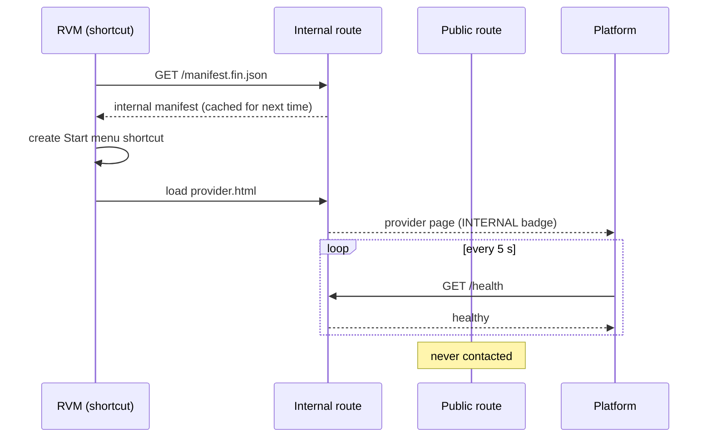

- **Goal:** show the normal case. The platform starts from the internal route, the Start menu shortcut is created, and no prompt appears.
- **Identity and cache state needed:** normal identity, cached or not. Running this scenario once is what caches the internal manifest for scenario 2.
- **Control panel settings:** both routes `healthy`.
- **Action:** `npm run client`.
- **What the user sees:** one platform window with a blue badge reading "INTERNAL route - app.example.internal". "Preferred route" shows yes, and "Other route" shows `app.example.com (http://127.0.0.1:5051)`. "This route" shows `healthy` and "Other route" under the health check shows `not checked yet`.
- **Log lines to expect:**
  - `Started from http://localhost:5050/manifest.fin.json on route internal (provider http://localhost:5050). Fallback manifests: http://127.0.0.1:5051/manifest.fin.json. Runtime 43.142.101.2. uuid support-network-fallback. Preferred: yes.`
  - `app.example.internal is healthy.`
  - Control panel: a `internal` `/health` request with status 200 every 5 seconds, and no `public` requests.
- **What it teaches:** on a healthy preferred route the only network cost of the pattern is one small check per interval. The other route is not touched.
- **Observed on Windows:** as expected. The startup and `healthy` lines matched the lines above, and the control panel showed `internal` requests 5 seconds apart and no `public` requests. The Start menu shortcut was created (see scenario 14).

### 2. Internal down at launch, with a cached manifest

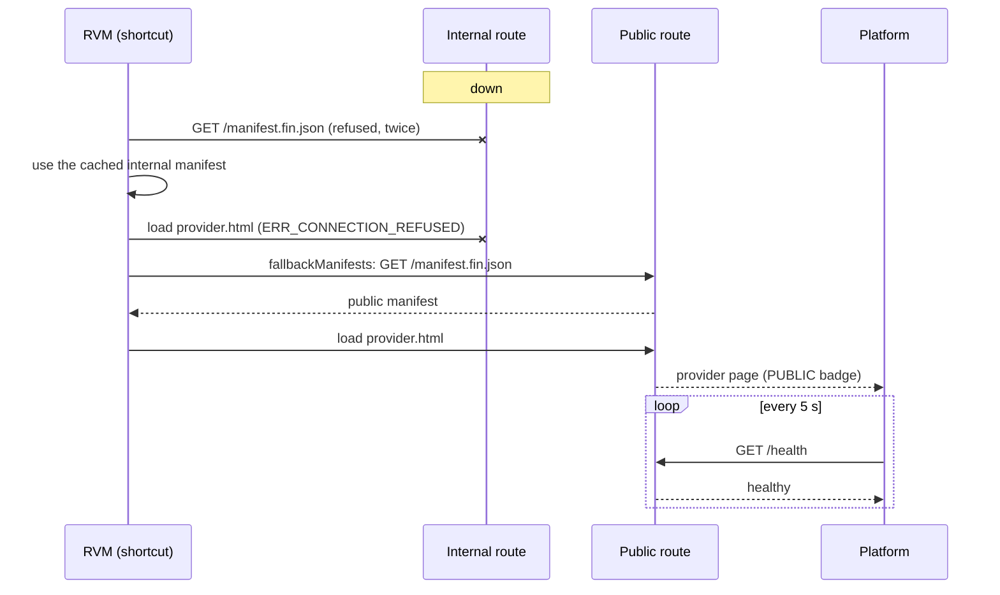

- **Goal:** show launch fallback: the RVM reads the cached internal manifest's `fallbackManifests` and starts the platform from the public route.
- **Identity and cache state needed:** normal identity, cached. Run scenario 1 first, then `npm run kill`.
- **Control panel settings:** internal `down`, public `healthy`.
- **Action:** `npm run client` (it still targets the internal manifest, as the shortcut does).
- **What the user sees:** after 18 to 26 seconds, the platform starts with an orange badge reading "PUBLIC route - app.example.com". "Preferred route" shows no and "Other route" shows `app.example.internal`. The Start menu shortcut still targets the internal manifest.
- **Log lines to expect:**
  - RVM log (`%LOCALAPPDATA%\OpenFin\logs\rvm.log`): two failed requests for the internal manifest, `JSON from cached config`, the provider failing to load with `ERR_CONNECTION_REFUSED`, then `FALLBACK_RESOLVER` trying `http://127.0.0.1:5051/manifest.fin.json`.
  - `Started from http://127.0.0.1:5051/manifest.fin.json on route public (provider http://127.0.0.1:5051). Fallback manifests: http://localhost:5050/manifest.fin.json. ... Preferred: no.`
  - `app.example.com is healthy.`
  - Control panel: `public` `/health` requests only. The internal route is not checked while the public route is healthy.
- **What it teaches:** one shortcut can start the platform on either route, but only because this machine has a cached copy of the internal manifest. The public manifest has no `shortcut` block, so the fallback launch never points the shortcut at the public manifest.
- **Observed on Windows:** as expected. The platform started on the public route 26 seconds after launch, with the startup line above and `FALLBACK_RESOLVER ... Finished OK 'http://127.0.0.1:5051/manifest.fin.json'` in the RVM log. The RVM rewrote the Start menu shortcut while starting the cached internal manifest, before it fell back, and the shortcut still targeted `http://localhost:5050/manifest.fin.json`.

### 3. First-ever launch with internal down (the gap)

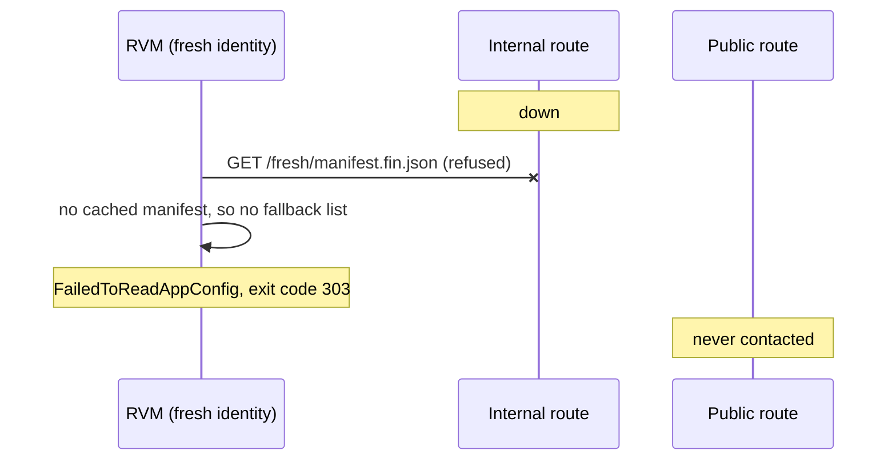

- **Goal:** show the known gap: with nothing cached, the RVM has no fallback list and the launch fails.
- **Identity and cache state needed:** fresh identity, never launched successfully on this machine.
- **Control panel settings:** internal `down`, public `healthy`. Set this **before** launching.

  > **Launch the fresh identity only with the internal route down. A successful launch caches this identity.**

- **Action:** `npm run client:fresh`. The script prints the same warning before launching.
- **What the user sees:** no platform starts.
- **Log lines to expect:**
  - RVM log: a failed request for `http://localhost:5050/fresh/manifest.fin.json`, `Failed to read the cached config file`, then `Result of loading primary application: FailedToReadAppConfig`. The public manifest is never requested.
  - Control panel: no `/health` requests, because no platform started.
- **What it teaches:** launch fallback cannot help a user whose first launch happens while the internal route is unavailable. The README's [Ideas to explore](../README.md#ideas-to-explore) lists approaches to try.
- **Observed on Windows:** as expected. The RVM logged `Failed to read the cached config file` and `FailedToReadAppConfig`, and exited with code 303 about 12 seconds after launch. No window appeared, and no folders were created under `%LOCALAPPDATA%\OpenFin` for the fresh identity, so it stayed fresh.

### 4. Internal server error at launch

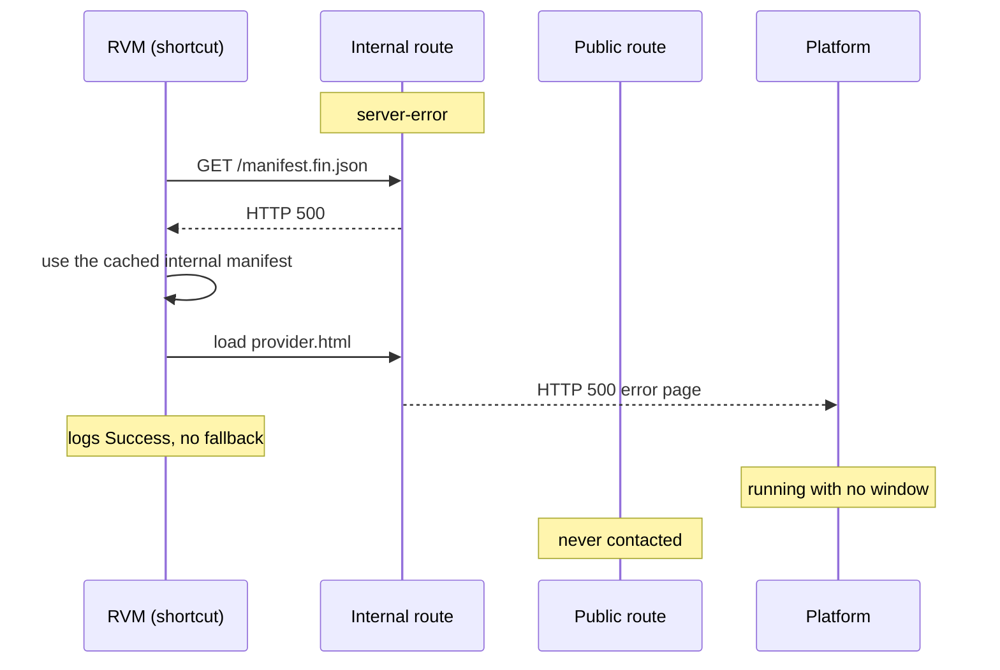

- **Goal:** show that an HTTP error on the internal route does not trigger launch fallback.
- **Identity and cache state needed:** normal identity, cached (run scenario 1 first).
- **Control panel settings:** internal `server-error`, public `healthy`.
- **Action:** `npm run client`.
- **What the user sees:** nothing. The RVM starts the platform from the cached internal manifest, but the provider page is an HTTP 500 error page, so the platform never initialises and no window appears. It does not move on to the public route.
- **Log lines to expect:**
  - RVM log: `Failed to get app config from 'http://localhost:5050/manifest.fin.json': Unhandled HTTP status code: 500`, `JSON from cached config`, then `Result of loading primary application: Success`, and no `FALLBACK_RESOLVER` entries.
  - Control panel: no `/health` requests, because the provider never runs.
- **What it teaches:** launch fallback needs a network-level failure, such as a refused connection or a host name that does not resolve. Make an unavailable internal route fail that way rather than answer with an error page.
- **Observed on Windows:** as expected, within 4 seconds of launch. The platform was left running without a window, so run `npm run kill` afterwards.

### 5. Both routes down at launch

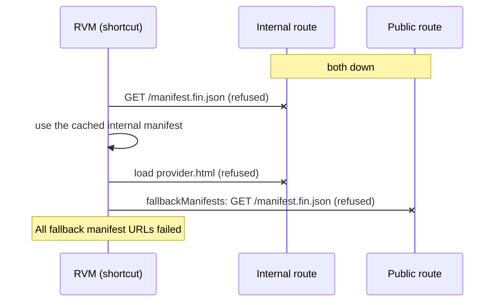

- **Goal:** show what happens when neither route can be reached.
- **Identity and cache state needed:** normal identity, cached (run scenario 1 first).
- **Control panel settings:** internal `down`, public `down`.
- **Action:** `npm run client`.
- **What the user sees:** no platform starts.
- **Log lines to expect:**
  - RVM log: the internal manifest failing, `FALLBACK_RESOLVER` entries for the public manifest, then `Finished with error: 'All fallback manifest URLs failed'`.
  - Control panel: no `/health` requests.
- **What it teaches:** fallback adds a second route, not offline operation. The two manifests list each other, and the RVM still stops after both fail.
- **Observed on Windows:** as expected. The RVM started the cached internal manifest, tried `http://127.0.0.1:5051/manifest.fin.json`, and logged `All fallback manifest URLs failed` about 37 seconds after launch. No window or error dialog appeared.

## Scenarios while running

### 6. Internal unhealthy while running

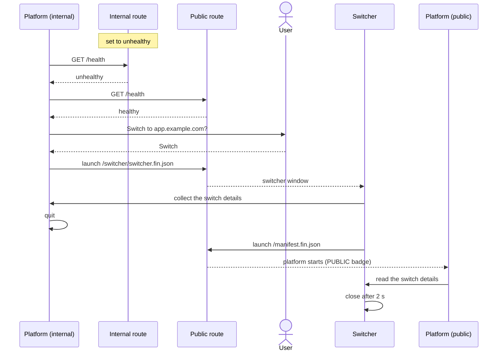

- **Goal:** show the full loop: check, find the current route unhealthy, check the other route, ask, switch.
- **Identity and cache state needed:** normal identity, cached or not.
- **Control panel settings:** both routes `healthy`. After the platform has started, set the internal route to `unhealthy`.
- **Action:** `npm run client`, wait for `healthy` in the app view, change the state, then click **Switch** in the prompt.
- **What the user sees:** within about 5 seconds, a "Switch to app.example.com?" window. It gives the reason and says the app will close and restart. On **Switch**, a small "Switching to app.example.com..." window appears, the platform closes, and it restarts with an orange badge.
- **Log lines to expect:**
  - `app.example.internal is unhealthy.`
  - `app.example.com is healthy.`
  - `Offering a switch: app.example.internal is unhealthy and app.example.com is healthy.`
  - `The user accepted the switch.`
  - Switcher window: `Switch <id>: internal to public. ...`, `Waiting up to 20 s for support-network-fallback to close.`, `Platform closed. Launching http://127.0.0.1:5051/manifest.fin.json`, `Started support-network-fallback.`, `The new platform read the switch details.` and `Closing in 2 s.`
  - The new platform: `Arrived from switch <id> (internal to public): on the intended route.`
  - Control panel: one `public` `/health` request just before the prompt.
- **What it teaches:** the other route is checked only once the current route is unhealthy, and the user always decides.
- **Observed on Windows:** as expected. The prompt appeared 4 seconds after the change, on the next check. After **Switch**, the new platform logged its startup line on the public route 7 seconds after the click, followed by `Arrived from switch <id> (internal to public): on the intended route.` No resolver events were shown in the switcher.

### 7. Internal down while running

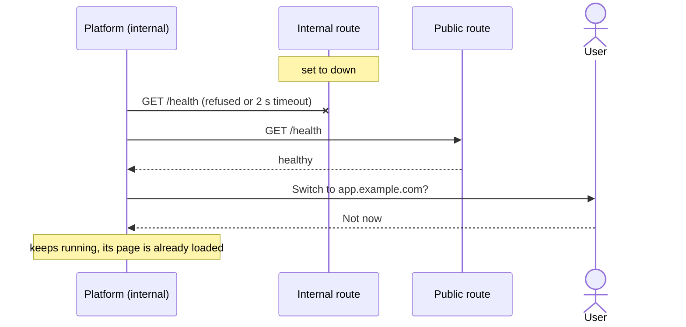

- **Goal:** show that an unreachable route is treated the same as one that reports unhealthy.
- **Identity and cache state needed:** normal identity, cached or not.
- **Control panel settings:** both routes `healthy`. After the platform has started, set the internal route to `down`.
- **Action:** `npm run client`, wait for `healthy`, change the state, then click **Not now** in the prompt.
- **What the user sees:** the prompt appears within about 7 seconds. The app keeps running from the internal route: its page and code are already loaded.
- **Log lines to expect:**
  - `app.example.internal is unreachable.` or `app.example.internal is not answering within 2000 ms.`
  - `app.example.com is healthy.`
  - `Offering a switch: ...`
  - Control panel: no `internal` requests, because the internal route is not listening.
- **What it teaches:** the health check does not need to know why a route is failing. Anything other than a healthy answer counts as unhealthy.
- **Observed on Windows:** as expected. The check logged `app.example.internal is not answering within 2000 ms.` and the prompt appeared about 4.5 seconds after the change.

### 8. Internal server error while running

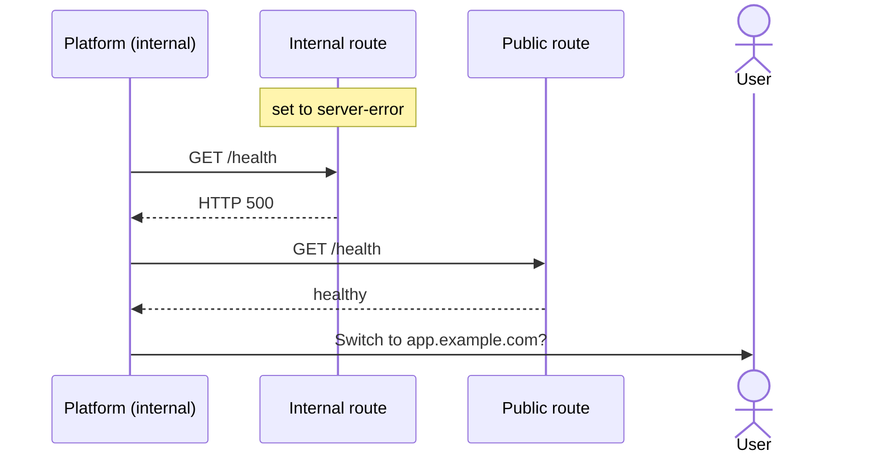

- **Goal:** show that an HTTP error from `/health` counts as unhealthy.
- **Identity and cache state needed:** normal identity, cached or not.
- **Control panel settings:** both routes `healthy`. After the platform has started, set the internal route to `server-error`.
- **Action:** `npm run client`, wait for `healthy`, change the state.
- **What the user sees:** the prompt appears within about 5 seconds.
- **Log lines to expect:**
  - `app.example.internal is returning HTTP 500.`
  - `app.example.com is healthy.`
  - `Offering a switch: app.example.internal is returning HTTP 500 and app.example.com is healthy.`
  - Control panel: `internal` requests with status 500.
- **What it teaches:** while running, an HTTP error is as bad as an unreachable route, even though at launch it does not trigger fallback (scenario 4).
- **Observed on Windows:** as expected. The lines above appeared 3 seconds after the change, on the next check.

### 9. Other route also unhealthy, so no offer

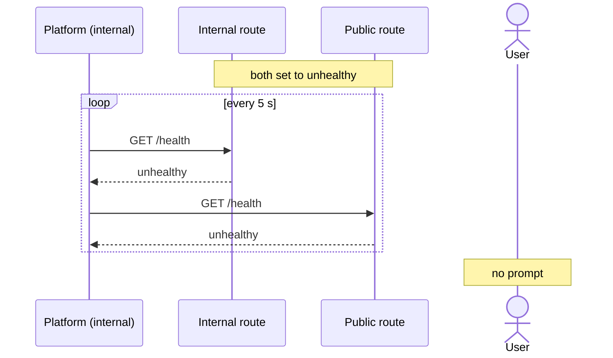

- **Goal:** show that the platform does not offer a route that is not healthy either.
- **Identity and cache state needed:** normal identity, cached or not.
- **Control panel settings:** both routes `healthy`. After the platform has started, set the public route to `unhealthy`, then the internal route to `unhealthy`.
- **Action:** `npm run client`, wait for `healthy`, change the states, and wait half a minute.
- **What the user sees:** no prompt. "This route" and "Other route" both show `unhealthy`, updated every 5 seconds.
- **Log lines to expect:**
  - `app.example.internal is unhealthy.`
  - `app.example.com is unhealthy.`
  - No `Offering a switch` line.
  - Control panel: a `internal` and a `public` request every 5 seconds, both with status 200 and state `unhealthy`.
- **What it teaches:** a switch is only offered to a healthy route. While the current route is unhealthy the other route is checked on every round; a real deployment would back off (see [Production hardening](../README.md#production-hardening)).
- **Observed on Windows:** as expected. No prompt appeared in 20 seconds, the two `unhealthy` lines were each logged once, and the control panel showed a `internal` and a `public` request every 5 seconds.

### 10. "Not now" asks again

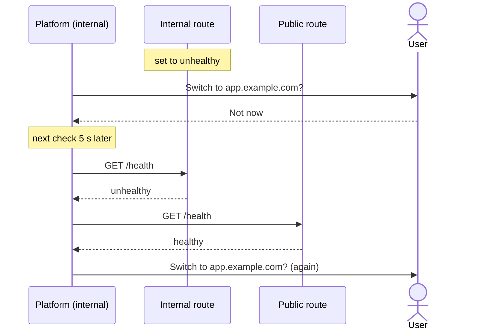

- **Goal:** show that this bare loop has no snooze.
- **Identity and cache state needed:** normal identity, cached or not.
- **Control panel settings:** both routes `healthy`. After the platform has started, set the internal route to `unhealthy`.
- **Action:** `npm run client`, wait for `healthy`, change the state, then click **Not now** when the prompt appears.
- **What the user sees:** the prompt closes and comes back about 5 seconds later.
- **Log lines to expect:**
  - `Offering a switch: app.example.internal is unhealthy and app.example.com is healthy.`
  - `The user declined the switch.`
  - About 5 seconds later, `Offering a switch: ...` again.
- **What it teaches:** the loop offers a switch whenever the current route is unhealthy and the other route is healthy. A real deployment would add a snooze; see [Production hardening](../README.md#production-hardening).
- **Observed on Windows:** as expected, run on the public route as part of scenario 11. `The user declined the switch.` was followed by a second `Offering a switch` line 4.3 seconds later.

### 11. On public, public unhealthy, so a move back is offered

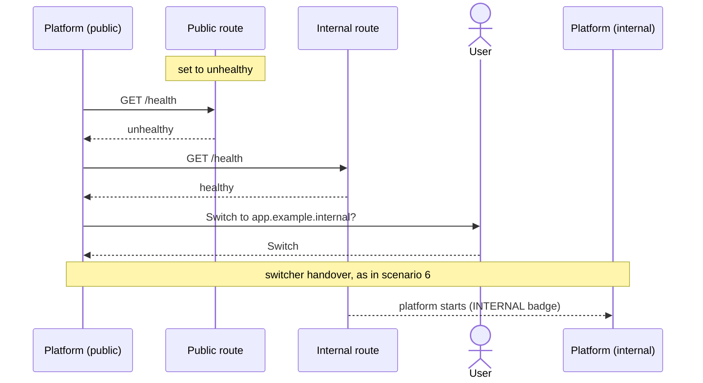

- **Goal:** show the loop in the other direction: running on the public route, the public route becomes unhealthy and the internal route is offered.
- **Identity and cache state needed:** normal identity, cached or not.
- **Control panel settings:** both routes `healthy`. After the platform has started, set the public route to `unhealthy`.
- **Action:** `npm run client:public`, wait for `healthy`, change the state, then click **Switch**.
- **What the user sees:** the platform starts with an orange badge. After the change, a "Switch to app.example.internal?" prompt appears. On **Switch**, the platform restarts with a blue badge.
- **Log lines to expect:**
  - `Started from http://127.0.0.1:5051/manifest.fin.json on route public ... Preferred: no.`
  - `app.example.com is unhealthy.`
  - `app.example.internal is healthy.`
  - `Offering a switch: app.example.com is unhealthy and app.example.internal is healthy.`
  - After the switch: `Arrived from switch <id> (public to internal): on the intended route.`
- **What it teaches:** the rule has no "preferred" flag: it moves away from an unhealthy route in either direction. A user on a healthy public route is not offered the internal route; see [Known gaps](../README.md#known-gaps).
- **Observed on Windows:** as expected, starting on the public route after the switch in scenario 12. The lines above appeared within a second of the change, and the platform was back on the internal route 6 seconds after **Switch**, with `Arrived from switch <id> (public to internal): on the intended route.`

### 12. Manual switch

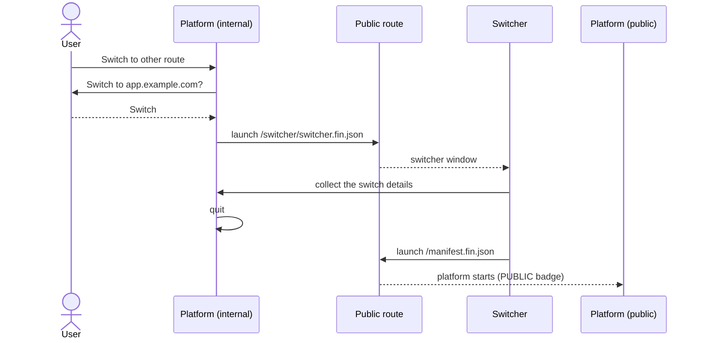

- **Goal:** try the switch without breaking a route.
- **Identity and cache state needed:** normal identity, cached or not.
- **Control panel settings:** both routes `healthy`.
- **Action:** `npm run client`. Click **Switch to other route**, then **Switch** in the prompt.
- **What the user sees:** the prompt appears at once. **Switch** restarts the platform on the public route.
- **Log lines to expect:**
  - `Offering a switch: You asked to switch.`
  - `The user accepted the switch.`
  - The switcher and arrival lines as in scenario 6.
- **What it teaches:** the switch is the same whatever triggers it.
- **Observed on Windows:** as expected. The switcher loaded from `http://127.0.0.1:5051/switcher/switcher.html`, collected the request 3 seconds after **Switch**, and the new platform logged `Arrived from switch <id> (internal to public): on the intended route.` 8.5 seconds after the click.

### 13. Switch fails

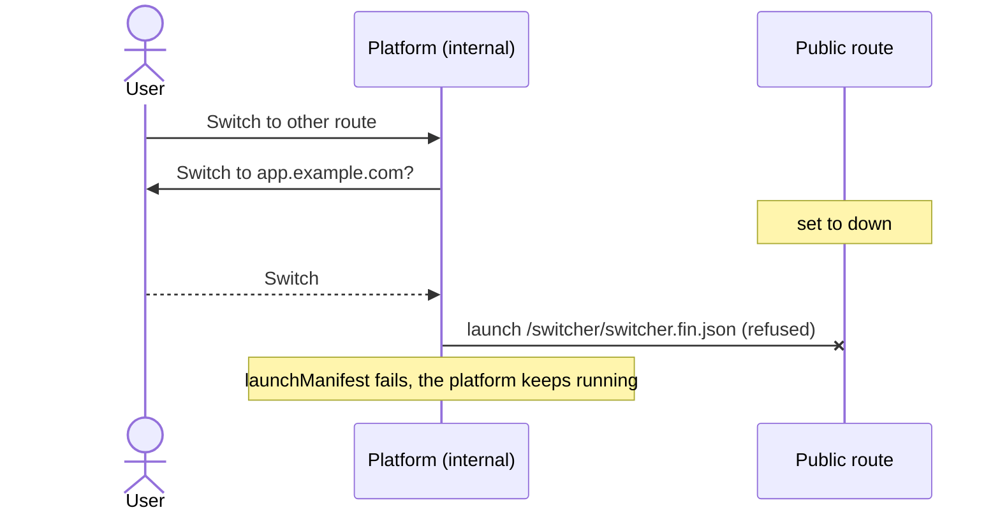

- **Goal:** show what happens when the destination goes down between the check and the switch.
- **Identity and cache state needed:** normal identity, cached or not.
- **Control panel settings:** both routes `healthy`. Get the prompt by clicking **Switch to other route**, then, **before** answering, set the public route to `down`.
- **Action:** `npm run client`, set things up as above, then click **Switch**.
- **What the user sees:** the switcher cannot be loaded from the public route, so the platform does not quit. It stays on the internal route.
- **Log lines to expect:**
  - `The user accepted the switch.`
  - `Switch failed to start: There was a problem adding the app to the queue`, after the RVM gives up on the switcher manifest.
- **What it teaches:** the platform only quits once the switcher has collected the switch request, so a switcher that cannot load leaves the platform running. The sample does not recover from failures after that point; see [Production hardening](../README.md#production-hardening).
- **Observed on Windows:** as expected, run from the public route with the internal route going down. The RVM logged `Failed to get app config from 'http://localhost:5050/switcher/switcher.fin.json'`, `launchManifest` failed 25 seconds after the click, and the platform kept running on the public route.

### 14. Start menu shortcut from the internal launch only

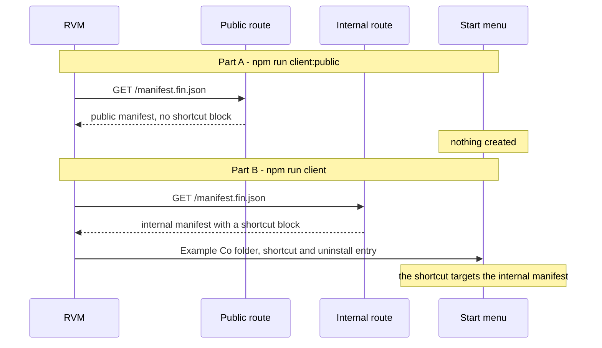

- **Goal:** show that the shortcut comes from the internal manifest and always targets it.
- **Identity and cache state needed:** normal identity. Delete any existing "Support Network Fallback" Start menu shortcut first.
- **Control panel settings:** both routes `healthy`.
- **Action:**
  - Part A: `npm run kill`, then `npm run client:public`. Look in the Start menu.
  - Part B: `npm run kill`, then `npm run client`. Look in the Start menu again, and check the shortcut's properties.
- **What the user sees:**
  - Part A: no shortcut is created, because the public manifest has no `shortcut` block.
  - Part B: an "Example Co" Start menu folder appears with a "Support Network Fallback" shortcut, targeting `OpenFinRVM.exe --config="http://localhost:5050/manifest.fin.json"`, and an "Uninstall Support Network Fallback" entry. No desktop shortcut is created.
- **Log lines to expect:** none in the app view. The RVM log has `SHORTCUTS` lines.
- **What it teaches:** the RVM creates the shortcut from the internal manifest's `shortcut` block, so there is no shortcut code in the platform, and the launch that creates it is also the launch that caches the internal manifest.
- **Observed on Windows:** as expected, once a leftover registry value had been removed. The earlier version of this sample had removed shortcuts through `Application.setShortcuts`, and the RVM had stored `EnableStartMenuShortcut = 0` for the internal manifest under `HKCU\Software\OpenFin\RVM\AppSettings`; while that value existed, the first part B launch created no shortcut. After deleting the key, part B created the shortcut and the uninstall entry described above. Part A created nothing.

## Launch experiment

### 15. Manifest served, provider fails

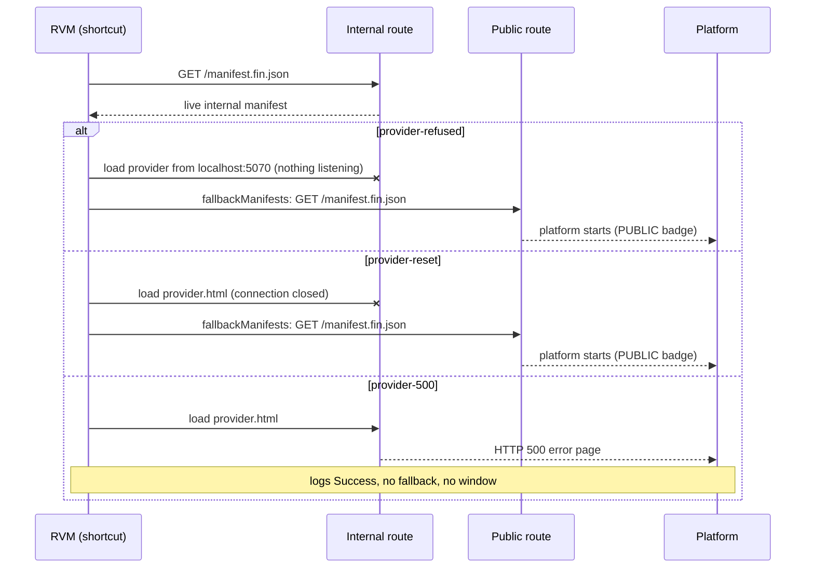

- **Goal:** find out which provider failures make the RVM fall back when the internal host is up and still serving the manifest.
- **Identity and cache state needed:** normal identity, cached (run scenario 1 first).
- **Control panel settings:** public `healthy`. Internal, one run each, with `npm run kill` in between:
  - `provider-refused`: the manifest points `providerUrl` at `http://localhost:5070/provider.html`, where nothing listens;
  - `provider-reset`: `/provider.html` closes the connection without answering;
  - `provider-500`: `/provider.html` returns HTTP 500.
- **Action:** `npm run client` for each.
- **What the user sees:**
  - `provider-refused` and `provider-reset`: the platform starts on the public route, with an orange badge.
  - `provider-500`: nothing. A platform is left running with no window.
- **Log lines to expect:**
  - `provider-refused` and `provider-reset`, RVM log: no `JSON from cached config` (the live manifest is used), then `Failed[CoreLoadError] Load error: FATAL ERROR: Failed to load URL in the app's main window`, `FALLBACK_RESOLVER ... Trying URL 'http://127.0.0.1:5051/manifest.fin.json'` and `Finished OK`. The provider logs `Started from http://127.0.0.1:5051/manifest.fin.json on route public`.
  - `provider-500`, RVM log: `Result of loading primary application: Success`, and no `FALLBACK_RESOLVER` entries.
- **What it teaches:** the fallback depends on the provider page failing as a connection, not on the manifest host being down. A provider that is broken but answers with an error page does not fall back. See [When the manifest is served but the provider fails](../README.md#when-the-manifest-is-served-but-the-provider-fails) for ways to make it fail as a connection.
- **Observed on Windows:** `provider-refused` fell back; the provider load failed about 10 seconds after the platform started and the platform was on the public route 26 seconds after launch. `provider-reset` fell back faster; the provider load failed within 2 seconds and the platform was on the public route 9 seconds after launch. `provider-500` did not fall back, and the platform was left running until `npm run kill`.
