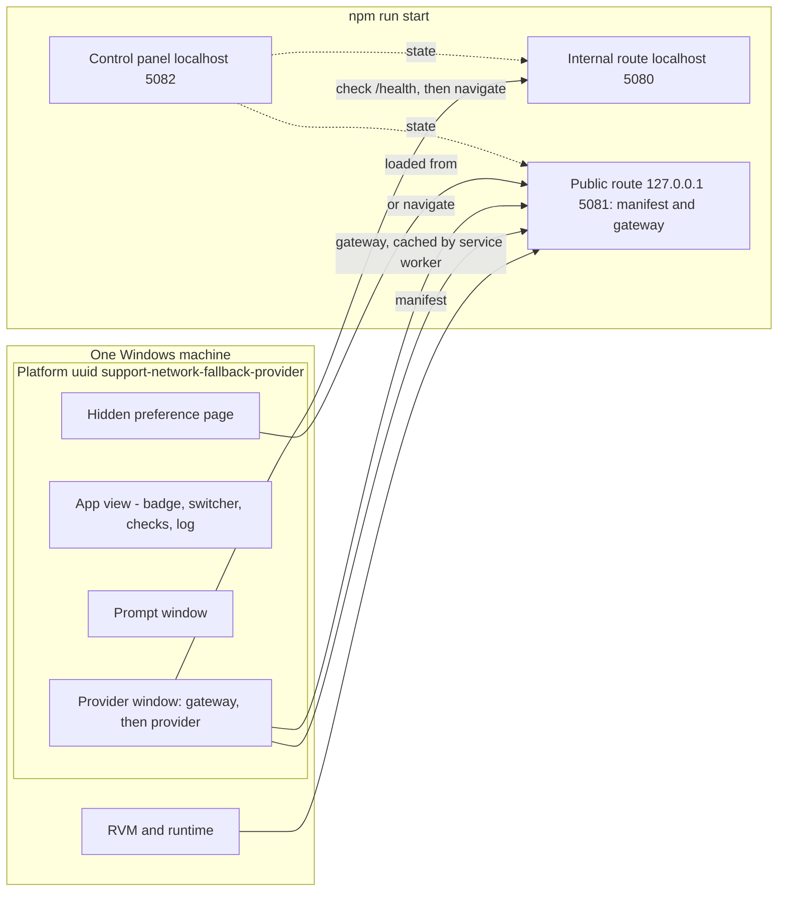
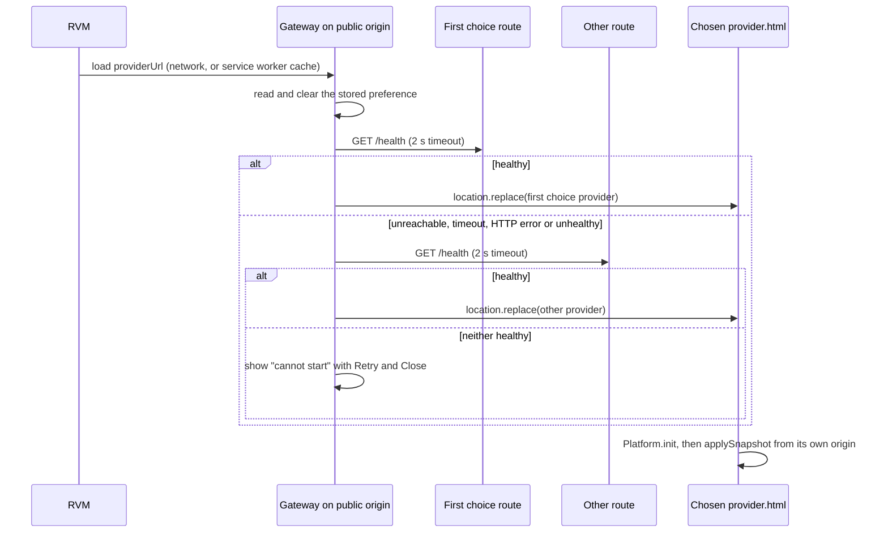
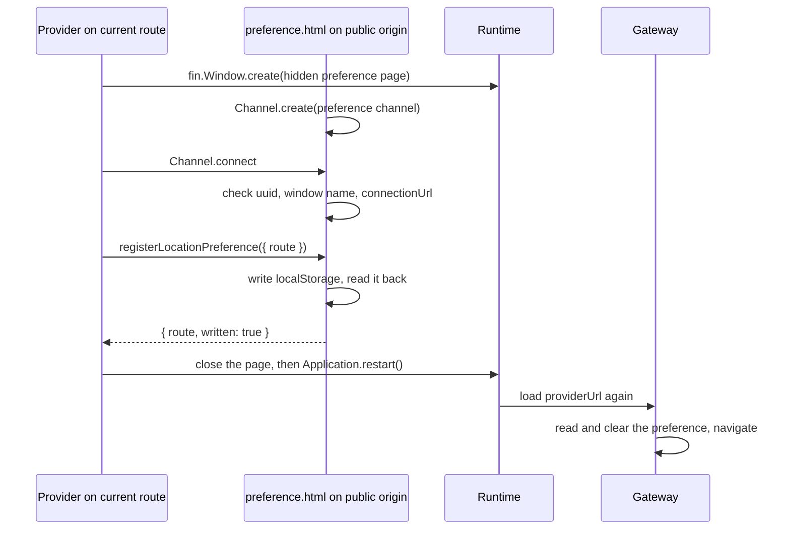

# Support network fallback: provider-based approach

This is one of two approaches to the same problem. The other is the [multi-manifest approach](../multi-manifest/), and [the overview](../README.md) compares them.

## What this shows

Some customers run the same HERE Core Container platform as two deployments: an internal deployment that users should prefer, and a public deployment to use when the internal one is not available. This guide calls each deployment a route.

This approach uses **one manifest, on the public route**. Its provider does not start as the normal provider page. It starts as a small **gateway** page on the public route, which:

1. reads a route preference the user may have stored with the in-app switcher, and clears it;
2. checks the `/health` of the chosen route, or of the internal route if none was chosen, and of the other route if that check fails;
3. navigates the provider window to the first healthy route's provider, or shows its own "cannot start" message with **Retry** and **Close** if neither route is healthy.

While running, the provider checks health as the multi-manifest approach does and offers a switch. A switch, whether offered or chosen in the app, stores a preference for the gateway and restarts the platform with `Application.restart()`.

The examples use `app.example.internal` for the internal route and `app.example.com` for the public route.

## Assumptions

- **Installing depends only on the public route.** The manifest, its `shortcut` block, the gateway, its service worker and the preference page are all served by the public route, so a first launch works anywhere the public route can be reached. The internal route is never needed to install. It is the preferred route, and the gateway navigates to it whenever its `/health` check passes.
- **The public route is normally available.** The gateway still checks it before navigating there, so a public outage gives a clear message instead of a provider that cannot load. The manifest has `offlineAccess: true` and the gateway is cached by a service worker, so a launch also survives the public route being briefly unreachable after a first launch; see [Observed results](#observed-results).
- **Internal `/health` needs no sign-in** and allows cross-origin requests (CORS) from the public origin, because the gateway runs on the public origin.

## This is an example, not production code

This is an example of how to use HERE manifests to configure HERE Core Container. Its purpose is to provide an example and suggestions. **DO NOT** assume that it contains production-ready code. Please use this as a guide and provide feedback. Thanks!

The health check and the gateway's decision are deliberately bare. [Production hardening](#production-hardening) lists what a real deployment should add.

## Quick start

These steps assume you are in this folder (`how-to/use-a-manifest/support-network-fallback/provider-based`) on Windows.

1. Install dependencies and do the initial build.

   ```shell
   npm run setup
   ```

2. Build the client bundles and the server.

   ```shell
   npm run build
   ```

3. Start the two route servers and the control panel in a new terminal. Leave it running.

   ```shell
   npm run start
   ```

4. Open the control panel at [http://localhost:5082](http://localhost:5082).

5. Launch the platform from the public manifest. This first launch caches the manifest, installs the gateway's service worker and creates the Start menu shortcut.

   ```shell
   npm run client
   ```

6. Close everything when you are done.

   ```shell
   npm run kill
   ```

The [scenarios document](./docs/scenarios.md) walks through each scenario: what to set in the control panel, what to do, what you should see and which log lines to expect.

## Pieces and ports

One Node process (`npm run start`) runs three HTTP servers. The ports differ from the multi-manifest approach, so both samples can be started on the same machine, and the platform uses its own uuid and security realm (`support-network-fallback-provider`).

| Piece          | Local address           | Stands in for                  | Serves                                                                                        |
| -------------- | ----------------------- | ------------------------------ | --------------------------------------------------------------------------------------------- |
| Internal route | `http://localhost:5080` | `https://app.example.internal` | `/provider.html`, `/app.html`, `/js`, `/health`                                               |
| Public route   | `http://127.0.0.1:5081` | `https://app.example.com`      | the same, plus `/manifest.fin.json` and `/gateway/`                                           |
| Control panel  | `http://localhost:5082` | nothing (test only)            | sets each route to `healthy`, `unhealthy`, `server-error` or `down`; shows `/health` requests |

The two routes use different host names, so their storage and cookies behave like two separate origins. The control panel and the fault layer that it drives are test tooling; [server/src/index.ts](./server/src/index.ts) is the only file that joins them to the deployment code.



## How it works

### The manifest

[server/src/deployment/manifests.ts](./server/src/deployment/manifests.ts) builds the one manifest, served only by the public route at `/manifest.fin.json`. Shared values (runtime version, arguments, uuid, ports) are in [shared/route-config.ts](./shared/route-config.ts).

- `platform.providerUrl` is the public `/gateway/index.html`.
- There is no `snapshot`. The view has to load from the route the gateway chose, which is not known when the manifest is written, so the provider builds the window from its own origin once it starts.
- There are no `fallbackManifests`. The gateway makes the choice instead of the RVM.
- `offlineAccess: true` lets the RVM start from its cached copy if the public route is briefly unreachable.
- The `shortcut` block (`target: ["start-menu"]`) creates a "Support Network Fallback (provider-based)" Start menu shortcut in an "Example Co" folder, pointing at the public manifest.

### The gateway

[client/src/gateway/gateway.ts](./client/src/gateway/gateway.ts) runs in the provider window before the provider does. The provider window is hidden while it decides; it is only shown if neither route can be used.



The decision order:

1. **The first choice is a stored preference.** The in-app switcher stores one before a restart; see [The switch](#the-switch). The gateway removes it from storage as soon as it reads it, so it applies to one start only.
2. **Otherwise the first choice is the preferred route**, which is the internal route.
3. **The first choice is used only if it is healthy**: its `/health` returns HTTP 200 with `{ "status": "healthy" }`, using the same rule as the running check in [client/src/health-check.ts](./client/src/health-check.ts). If not, the gateway checks the other route the same way and uses it if it is healthy, even when the user chose the first route.
4. **If neither route is healthy**, the gateway shows the provider window with the reason for each route. **Retry** hides the window and runs the checks again, and **Close** quits the platform.

The gateway then calls `location.replace()` with the chosen route's `/provider.html`, adding its decision to the query string (`selectedBy` is `preference`, `health` or `fallback`, plus `detail` and the service worker state). The provider logs it and the app view shows it.

The health check here assumes `/health` needs no sign-in. If yours does, the gateway could instead test only whether the internal host can be reached at all, for example with a `no-cors` request to a static file, which tells you the network path is there but not whether the services behind it are working.

### The service worker

[public/gateway/sw.js](./public/gateway/sw.js) is registered by the gateway with the scope `/gateway/`, so it controls only the gateway and the preference page. The providers and views on either route are never controlled by it.

- On install it caches `/gateway/index.html`, `/gateway/gateway.css`, `/js/gateway.bundle.js`, `/gateway/preference.html` and `/js/preference.bundle.js`.
- It answers those files network-first, with a 3-second timeout, and uses the cache only when the network fails, so a new gateway is picked up as soon as it is deployed.
- Every other request, including `/health`, goes to the network untouched.
- The server sends `sw.js` itself with `Cache-Control: no-cache`, so the browser checks for a new service worker each time it is registered.

It is plain JavaScript rather than a webpack bundle, so its URL and scope stay fixed.

On a first launch the gateway page is not yet controlled by the service worker, which is installed during that launch. From the second launch on, the app view shows `page served through the service worker`.

### The provider

[client/src/provider.ts](./client/src/provider.ts) calls `fin.Platform.init()` and then applies a snapshot whose view URL is `${location.origin}/app.html`, so the view always comes from the route the gateway chose. [client/src/routes.ts](./client/src/routes.ts) works out the current route from `location.origin`; the other route is simply the other entry in [shared/route-config.ts](./shared/route-config.ts).

### The health check while running

The loop is the same as in the multi-manifest approach: check the current route's `/health` every 5 seconds with a 2-second timeout, check the other route only while the current route is unhealthy, and offer a switch with the prompt in [client/src/prompt.ts](./client/src/prompt.ts) when the other route is healthy. See [Part 2 of the multi-manifest README](../multi-manifest/README.md#part-2-health-check-and-switch) for the details and its limits.

### The switch



The gateway reads the preference from `localStorage` on the public origin. A provider running on the internal origin cannot write that storage directly, because storage belongs to an origin. An iframe from the public origin would not work either, because Chromium partitions a third-party frame's storage by the top-level site, so the gateway would never see the value. So [client/src/switch.ts](./client/src/switch.ts) opens a hidden top-level window on the public origin, [public/gateway/preference.html](./public/gateway/preference.html), and asks it over a channel to store the value.

[client/src/gateway/preference.ts](./client/src/gateway/preference.ts) creates the `support-network-fallback-provider/preference` channel and rejects every connection unless:

- the client's uuid is the platform's uuid;
- the client is a window whose name is the uuid, which is the platform's provider window;
- the client's `connectionUrl`, without its query string, is exactly the internal or the public `/provider.html`.

Once connected, the provider calls `registerLocationPreference({ route })`. The page accepts only `internal` or `public`, writes the value, reads it back, and returns `{ route, written: true }`. Only then does the provider close the page and call `fin.Application.getCurrentSync().restart()`. The restart API is on `Application`; `fin.System` has none. If any step fails or takes more than 10 seconds, the provider logs `Switch failed: ...`, closes the page and keeps running on its current route. The page closes itself if no valid client connects within 10 seconds.

Before any of this, the provider checks the destination route's `/health`. If it fails, nothing is stored, the platform is not restarted, and the provider logs `Not switching: <host> is <reason>. Staying on <current host>.` Without this check, a switch to a route that is down would restart into a gateway that has to fall back again.

The switcher in the app view has a button for each route. It goes straight to the switch without the prompt, because the user has already chosen. The running health check uses the prompt first.

### Simpler on purpose

The restart closes every window and loses everything held in memory. That keeps the code small, and the running platform is always exactly what the gateway would start. There are more complex options, which this sample does not implement:

- **Carry the layout across.** Before restarting, capture the platform snapshot with `Platform.getSnapshot()`, rewrite each view URL from the old origin to the new one, store it somewhere the new provider can read, and apply it after `Platform.init()` instead of the default window.
- **Navigate in place.** Skip the restart: navigate each view to the same path on the other origin, and navigate the provider window too, or keep it where it is. Windows stay open, but the provider may need to reload, and storage and sign-in still change with the origin.

[What to carry across a switch](../multi-manifest/README.md#what-state-to-carry-across-a-switch) in the multi-manifest README discusses the state you would need to handle in either case.

## Compared with the multi-manifest approach

**What this approach gains:**

- **No first-launch gap.** A first launch only needs the public route, so a new user who cannot reach the internal deployment on their first day can still start the platform.
- **One manifest and one `apps` folder**, so there is no second manifest to keep in step and no shortcut-ownership rule to remember.
- **No dependency on RVM fallback behaviour.** The multi-manifest approach only falls back on network-level failures of the provider. Here the gateway treats an HTTP error, a timeout, an unhealthy answer or a sign-in page from `/health` the same way.
- **Switching is a restart, not a second app.** There is no switcher manifest that has to match the platform's runtime version and realm.

**What it costs:**

- **The public route is on every launch's path.** The manifest and gateway come from it. The cached copies help when it is briefly unreachable, but it must be sized and kept available like the internal route.
- **A health check on every launch.** Internal users wait for one `/health` request before the provider loads; about half a second in this sample. Public users wait for two, and the first may run to its 2-second timeout.
- **Code you maintain.** The gateway, the service worker and the preference page are yours to write, test and update.
- **The public page checks an internal host.** See Private Network Access in [Known gaps](#known-gaps).

## Observed results

These results were recorded on Windows with runtime `43.142.101.2` and `@openfin/core` `43.101.2`. The per-scenario results are in [the scenarios document](./docs/scenarios.md).

| Check                                                                                                                                  | Result                                                                                                                                                         |
| -------------------------------------------------------------------------------------------------------------------------------------- | -------------------------------------------------------------------------------------------------------------------------------------------------------------- |
| The provider window can navigate from the gateway (public origin) to a provider on another origin and call `fin.Platform.init()` there | Yes                                                                                                                                                            |
| The view opened by the provider loads from the provider's origin                                                                       | Yes, `http://localhost:5080/app.html` on the internal route                                                                                                    |
| The service worker installs on the first launch and serves the gateway on later launches                                               | Yes; the first launch logged `page not controlled yet, service worker active`, and later ones `page served through the service worker`                         |
| `Application.restart()` restarts the platform at the gateway URL                                                                       | Yes, the new provider was running on the chosen route about 3 seconds after the switch was requested                                                           |
| The preference page rejects a client that is not the provider                                                                          | Yes; a node adapter client was rejected with `uuid ... is not this platform`                                                                                   |
| The preference is cleared once read                                                                                                    | Yes; the next launch chose the internal route by health check                                                                                                  |
| Public route down after a first launch, internal healthy                                                                               | The RVM used its cached manifest, the gateway came from the service worker cache, and the platform started on the internal route about 15 seconds after launch |
| Both routes down                                                                                                                       | The gateway (from the cache) showed "Support Network Fallback cannot start" with the reason for each route, and Retry and Close buttons                        |
| Switching with the in-app button to a route that is down                                                                               | Refused without a restart: `Not switching: app.example.com is not answering within 2000 ms. Staying on app.example.internal.`                                  |
| The shortcut                                                                                                                           | The public manifest's `shortcut` block created "Support Network Fallback (provider-based)" and its uninstall entry in the Start menu                           |

Not observed here: a first install on a machine that has never run the sample, and the effect of Private Network Access, which the localhost simulator cannot reproduce.

## Known gaps

- **Private Network Access.** The gateway is a page on a public origin that requests an internal address. Chromium increasingly restricts such requests; the internal route may need to answer preflight requests with `Access-Control-Allow-Private-Network: true`, and future runtimes may require more. Test this against your real hosts.
- **A healthy `/health` does not guarantee the provider loads.** If the internal `/health` is open but the internal provider sits behind a sign-in page, the gateway navigates there anyway. Make `/health` reflect what the provider needs, or add a ready signal; see [Production hardening](#production-hardening).
- **Both routes unavailable.** The gateway can only say so and offer **Retry**. It needs either the network or the service worker cache to load at all; on a machine that has never launched the sample, the RVM's own error appears instead.
- **A route can fail between the check and the navigation.** The gateway and the switch both check `/health` first, but if the route fails in the moment after, the runtime shows its own "Failed to load" error, which names the gateway URL because that is the manifest's `providerUrl`.
- **Per-route storage and sign-in.** The routes are different origins, so storage and cookies are separate. A user who switches may need to sign in again.
- **Service worker updates.** A new `sw.js` is picked up on the next registration, and a new gateway is fetched network-first, but a launch while the public route is unreachable uses whatever was cached last. Bump `CACHE_NAME` when the cached files change in a way that matters.
- **A chosen route can be overridden silently.** If the user chose a route but it fails the gateway's check, the gateway uses the other route and the preference is gone, because it is cleared as soon as it is read. Only the app view's "Chosen by the gateway" row says why.
- **Windows only, as tested.** The sample's launch script and observations are for Windows.

## Production hardening

None of the following is built into this sample. The [multi-manifest list](../multi-manifest/README.md#production-hardening) applies to the running health check here too: jitter, backoff, `Retry-After`, several failures before acting, a snooze after "Not now", and so on. Specific to the gateway:

- **A ready signal.** The gateway navigates and forgets. A real gateway could keep a record (for example in session storage, or a value the provider writes back through the preference page) and, if the chosen provider never starts, choose the other route on the next attempt.
- **Prefer the internal route again.** A platform that fell back stays on the public route until it restarts. The running check could look at the internal route occasionally while on the public route and offer to move back.
- **Short gateway timeouts.** Every second the gateway waits is added to every launch. Keep the `/health` timeout short, and consider a server-supplied setting.
- **Proving the answer is real.** A captive portal or proxy can answer `/health` with HTTP 200. Send a random value and require the server to echo it.
- **Lock down the gateway origin.** The gateway and preference page run with the platform's permissions; serve them with a strict Content Security Policy, and keep the list of provider URLs that the preference page accepts in step with your deployments.

## Moving to real hosts

- **HTTPS.** Serve the manifest, gateway, service worker, providers, views and `/health` over HTTPS. Service workers need a secure context; `localhost` and `127.0.0.1` count as secure in the sample, real hosts must use HTTPS.
- **Host names.** Replace the hosts and ports in [shared/route-config.ts](./shared/route-config.ts). The provider URLs the preference page accepts are built from the same config.
- **Health.** Pass your own `status()` source to `createRouteServer` in place of the simulator's.
- **CORS.** The gateway checks the internal `/health` from the public origin, so it must send `Access-Control-Allow-Origin` for the public origin. The sample sends `*`; a real server should name the origin.
- **Caching.** Keep `Cache-Control: no-store` on the manifest and `/health`, and `no-cache` on `sw.js`.

## What to take into your own app

| Area       | Files                                                                                                                                                                           |
| ---------- | ------------------------------------------------------------------------------------------------------------------------------------------------------------------------------- |
| Shared     | [shared/route-config.ts](./shared/route-config.ts), [shared/health-contract.ts](./shared/health-contract.ts)                                                                    |
| Deployment | [server/src/deployment/](./server/src/deployment/) (`create-route-server.ts`, `manifests.ts`, `health.ts`)                                                                      |
| Gateway    | [client/src/gateway/](./client/src/gateway/) (`gateway.ts`, `decision.ts`, `preference.ts`) and [public/gateway/](./public/gateway/) (`index.html`, `preference.html`, `sw.js`) |
| Provider   | [client/src/](./client/src/) (`provider.ts`, `routes.ts`, `health-check.ts`, `prompt.ts`, `switch.ts`)                                                                          |

The test tooling, which you should not copy: [server/src/simulator/](./server/src/simulator/), [public/control/index.html](./public/control/index.html) and [server/src/index.ts](./server/src/index.ts). The app view ([client/src/app.ts](./client/src/app.ts)) and the status channel exist to make the decisions visible; your own UI would replace them.

## Where to look

- **Provider log:** the gateway's lines start with `[gateway]` and are followed by the provider's lines, because both run in the same window. They are written to `app.log` in the sample's folder under `%LOCALAPPDATA%\OpenFin\apps`, and to the provider's console (the runtime arguments include `--inspect`).
- **Preference page:** its `Stored the preference ...` and `Rejected a connection: ...` lines are in the same `app.log`.
- **App view:** the route badge, how the gateway chose the route, the service worker state, the switcher, the last check of each route and the last 20 log lines.
- **RVM log:** `%LOCALAPPDATA%\OpenFin\logs\rvm.log`, for whether the manifest came from the network or the cache.
- **Control panel log:** every `/health` request each route received.

## Removing the sample

1. Close everything with `npm run kill`. This closes every OpenFin application you have running, not only this sample.
2. List the sample's folders, check the list, then delete them:

   ```powershell
   Get-ChildItem "$env:LOCALAPPDATA\OpenFin\apps" -Directory |
     Where-Object { Select-String -Path "$($_.FullName)\config.json" -Pattern "support-network-fallback-provider" -Quiet -ErrorAction SilentlyContinue }
   Get-Item "$env:LOCALAPPDATA\OpenFin\cache\support-network-fallback-provider"
   ```

   The cache folder holds the gateway's service worker and the stored preference, as well as the rest of the platform's storage.

3. Delete "Support Network Fallback (provider-based)" and its uninstall entry from the "Example Co" folder in `%APPDATA%\Microsoft\Windows\Start Menu\Programs`.
