# Support network fallback (provider-based): scenarios

## This is an example, not production code

This is an example of how to use HERE manifests to configure HERE Core Container. Its purpose is to provide an example and suggestions. **DO NOT** assume that it contains production-ready code. Please use this as a guide and provide feedback. Thanks!

## How to use this document

Each scenario below is a walkthrough you can run against the sample. Start with the [Quick start](../README.md#quick-start) in the README, then keep `npm run start` running in one terminal and use another for `npm run client` and `npm run kill`.

Every scenario uses the same template:

- **Goal:** what the scenario shows.
- **Control panel settings:** which state to give each route at [http://localhost:5082](http://localhost:5082).
- **Action:** what to launch or click.
- **What the user sees:** the route badge, prompts and windows.
- **Log lines to expect:** lines in the app view's log, also written to `app.log` (the gateway's lines start with `[gateway]`).
- **Observed on Windows:** the result recorded against runtime `43.142.101.2`, where it was run.

The internal route is `localhost:5080` (standing in for `app.example.internal`) and the public route is `127.0.0.1:5081` (standing in for `app.example.com`). Unless a scenario says otherwise, run `npm run kill` first and set both routes to `healthy`.

## Scenarios at launch

### 1. First launch with the internal route healthy

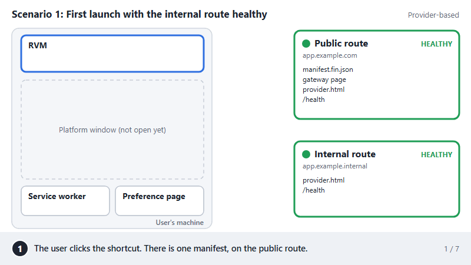

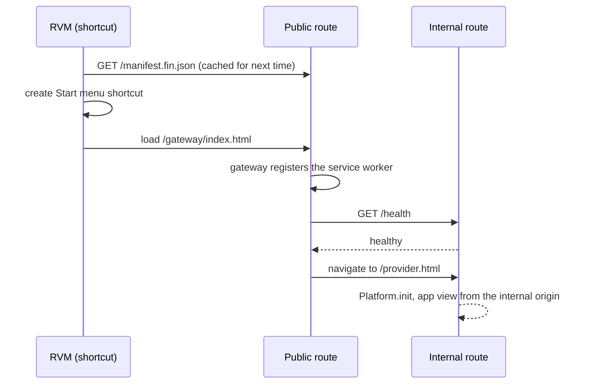

- **Goal:** show the normal case: the platform starts from the public manifest and runs on the internal route.
- **Control panel settings:** both routes `healthy`.
- **Action:** `npm run client`.
- **What the user sees:** a platform window with a blue "INTERNAL route - app.example.internal" badge. "Chosen by the gateway" shows `health: app.example.internal is healthy`.
- **Log lines to expect:**
  - `[gateway] Checking app.example.internal...`
  - `[gateway] Using app.example.internal (health: app.example.internal is healthy). Service worker: page not controlled yet, service worker active.`
  - `Started from http://127.0.0.1:5081/manifest.fin.json on route internal (provider http://localhost:5080). ... Preferred: yes.`
- **Observed on Windows:** as expected. The provider was running on the internal origin about 2 seconds after the gateway loaded. A "Network Fallback Provider-Based" Start menu shortcut and its uninstall entry were created.

### 2. First install with the internal route down

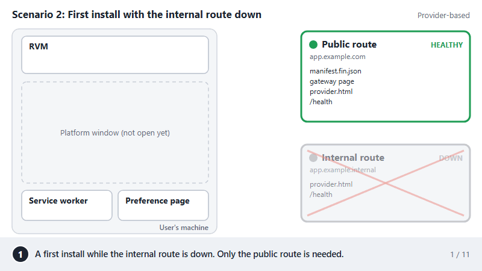

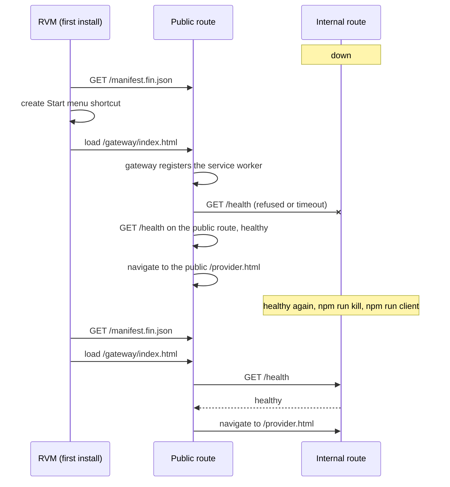

- **Goal:** show that installing needs only the public route.
- **Control panel settings:** internal `down`, public `healthy`. Ideally on a machine, or after [removing the sample](../README.md#removing-the-sample), where the sample has never run.
- **Action:** `npm run client`. Then set the internal route to `healthy`, run `npm run kill` and `npm run client` again.
- **What the user sees:** the first launch starts on the public route with an orange badge. The second starts on the internal route.
- **Log lines to expect:** `[gateway] Using app.example.com (fallback: app.example.internal is not answering within 2000 ms; app.example.com is healthy)` or `... is unreachable; ...`, then on the second launch `Gateway chose this route by health`.
- **Observed on Windows:** the launch with the internal route down was run on a machine where the sample had already been installed (scenario 3); a clean first install was not run. Nothing in the gateway depends on a cached copy, and the manifest and gateway come only from the public route.

### 3. Internal down or unhealthy at launch

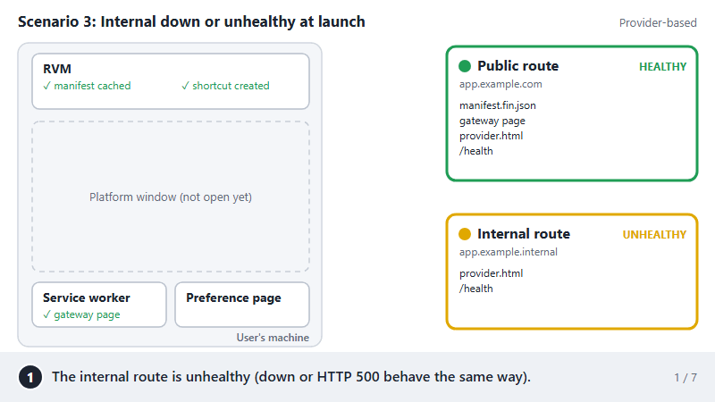

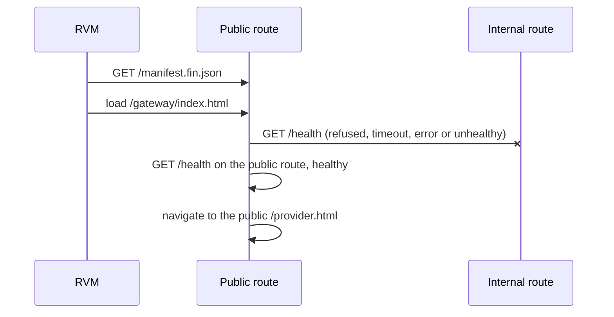

- **Goal:** show the gateway falling back.
- **Control panel settings:** internal `down`, `unhealthy` or `server-error`; public `healthy`.
- **Action:** `npm run client`.
- **What the user sees:** the platform starts with an orange "PUBLIC route - app.example.com" badge. "Chosen by the gateway" shows `fallback: ...`.
- **Log lines to expect:** `Gateway chose this route by fallback: app.example.internal is unhealthy; app.example.com is healthy.`, with `is not answering within 2000 ms` or `is returning HTTP 500` in place of `is unhealthy`.
- **Observed on Windows:** as expected for `unhealthy` and `down`. With `down`, the refused connection took the full 2-second timeout, as it does on Windows for local ports.

### 4. Public down after a first launch

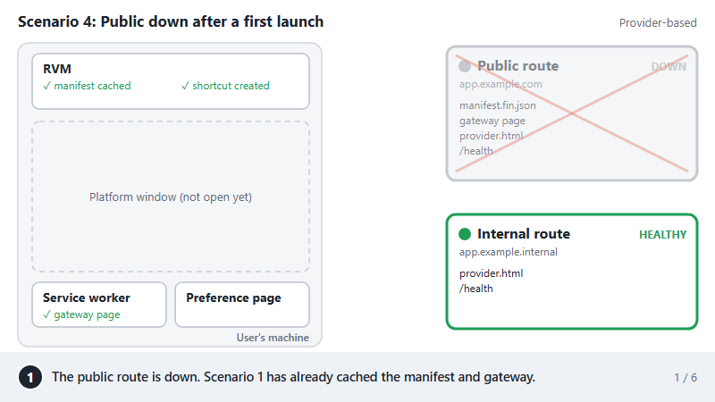

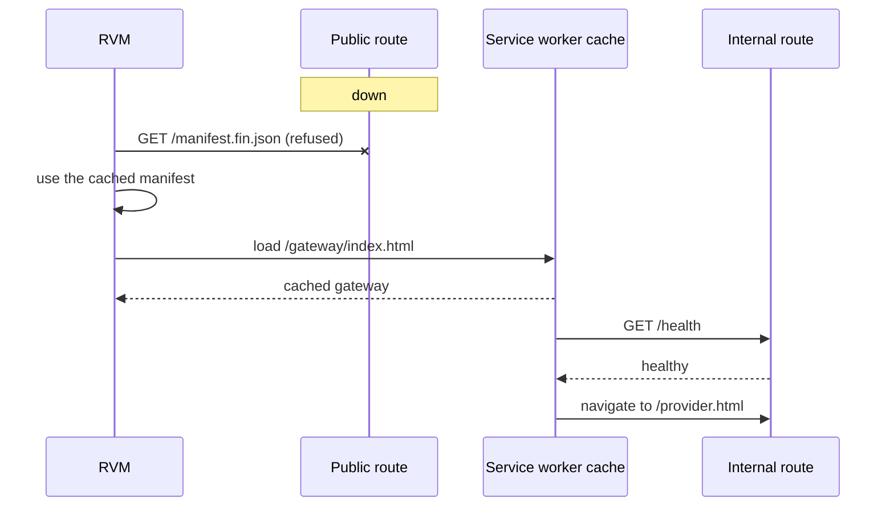

- **Goal:** show that the cached manifest and the cached gateway still let the platform start on the internal route.
- **Control panel settings:** internal `healthy`, public `down`. Run scenario 1 first, so the manifest and gateway are cached.
- **Action:** `npm run client`. The control panel keeps running while a route is down, so the script still gets the launch command.
- **What the user sees:** after about 15 seconds, the platform starts with a blue badge. "Gateway service worker" shows `page served through the service worker`.
- **Observed on Windows:** as expected. The RVM retried the manifest, used its cached copy, and the gateway loaded from the service worker cache 2 seconds later, once its network attempt failed. The provider was running on the internal route 15 seconds after launch.

### 5. Both routes down

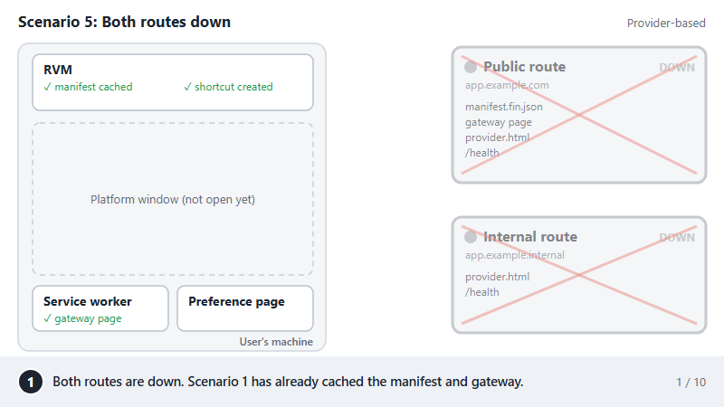

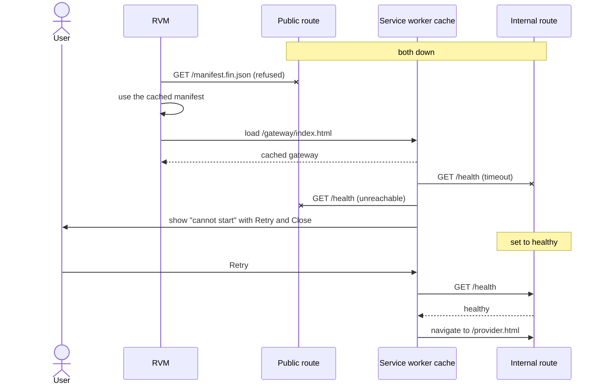

- **Goal:** show what the gateway does when it cannot use either route.
- **Control panel settings:** both `down`, after scenario 1.
- **Action:** `npm run client`. Then set the internal route to `healthy` and click **Retry**.
- **What the user sees:** after about 15 seconds of RVM retries and two 2-second checks, a small "Support Network Fallback cannot start" window with the reason for each route and **Close** and **Retry** buttons. After **Retry**, the window hides and the platform starts on the internal route. **Close** quits the platform.
- **Log lines to expect:** `[gateway] Neither route is available: app.example.internal is not answering within 2000 ms; app.example.com is unreachable.`
- **Observed on Windows:** the window appeared as described, loaded from the service worker cache. The **Retry** click was not automated.

## Scenarios while running

### 6. Internal unhealthy while running

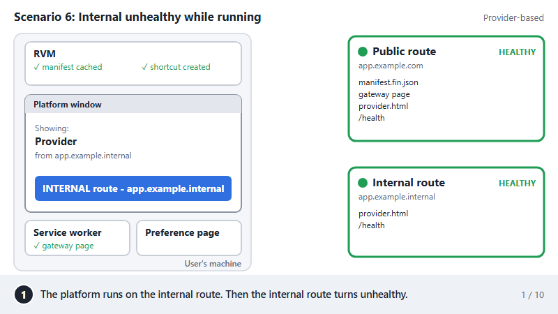

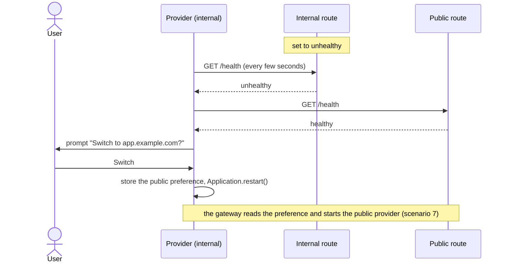

- **Goal:** show the running check offering a switch.
- **Control panel settings:** both `healthy`. After the platform has started on the internal route, set the internal route to `unhealthy`.
- **Action:** `npm run client`, change the state, then click **Switch** in the prompt.
- **What the user sees:** within about 5 seconds, a "Switch to app.example.com?" prompt. On **Switch**, the platform closes and restarts with an orange badge, and "Chosen by the gateway" shows `preference: stored preference for app.example.com, and app.example.com is healthy`.
- **Log lines to expect:**
  - `app.example.internal is unhealthy.`, `app.example.com is healthy.`
  - `Offering a switch: app.example.internal is unhealthy and app.example.com is healthy.`
  - `The user accepted the switch.`, `Switching to app.example.com (...). Storing the preference, then restarting.`
  - `Stored the preference for the public route.` (from the preference page)
- **Observed on Windows:** the offer appeared within 5 seconds of the change. The click on **Switch** was not automated; accepting runs the same switch as scenario 7.

### 7. The in-app switcher

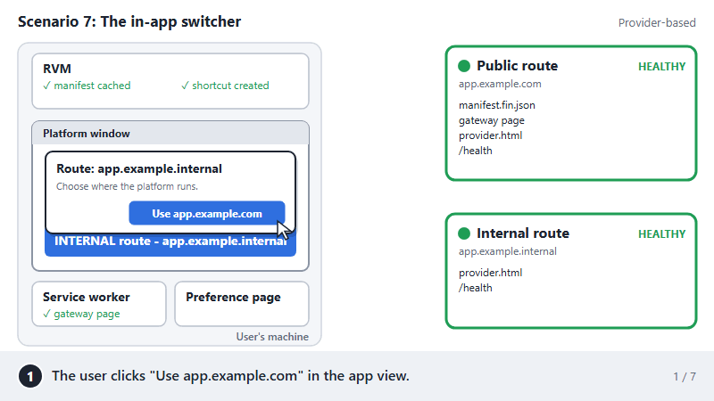

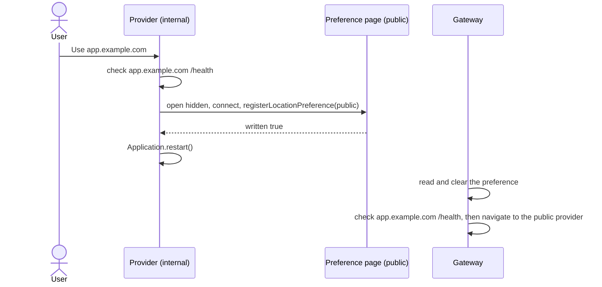

- **Goal:** show a user-chosen switch.
- **Control panel settings:** both `healthy`.
- **Action:** `npm run client`, then click **Use app.example.com** in the app view.
- **What the user sees:** the platform restarts with an orange badge. The button for the current route is disabled.
- **Log lines to expect:** `Switching to app.example.com (you chose app.example.com in the app). ...`, `Stored the preference for the public route.`, `[gateway] Using app.example.com (preference: stored preference for app.example.com, and app.example.com is healthy)`.
- **Observed on Windows:** as expected, triggered through the status channel's `switch-to` request, which is what the button sends. The preference was stored 1.2 seconds after the request and the new provider was running on the public route 3 seconds after it.

### 8. Switching to a route that is down

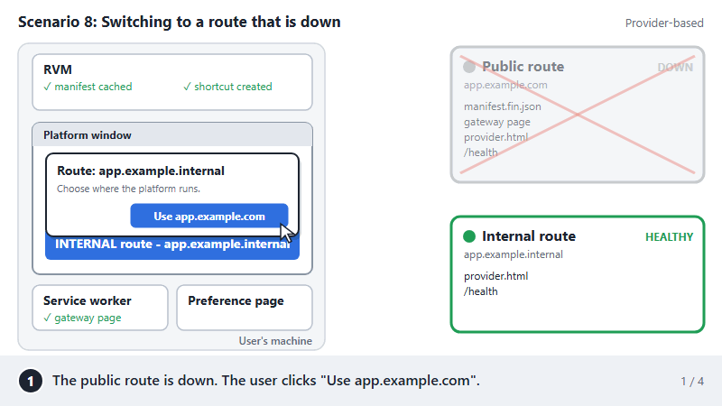

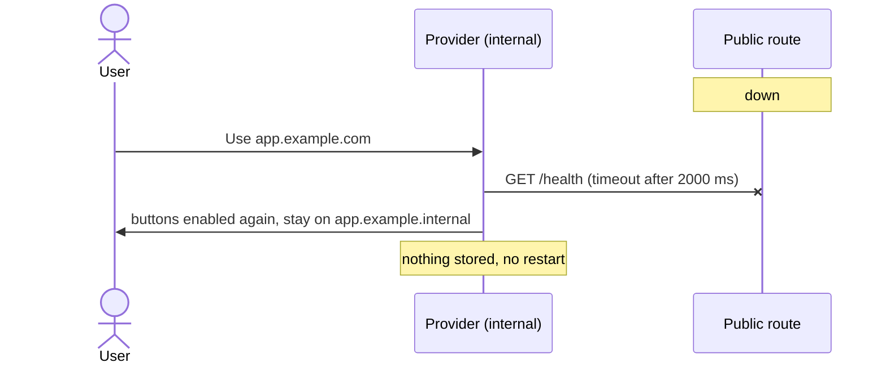

- **Goal:** show that the switcher checks the destination before restarting.
- **Control panel settings:** both `healthy`. After the platform has started on the internal route, set the public route to `down`.
- **Action:** click **Use app.example.com** in the app view.
- **What the user sees:** after about 2 seconds the buttons are enabled again and the platform keeps running on the internal route. Nothing is stored and nothing restarts.
- **Log lines to expect:** `Not switching: app.example.com is not answering within 2000 ms. Staying on app.example.internal.`
- **Observed on Windows:** as expected, through the `switch-to` request. Before this check was added, the switch stored the preference and restarted, and the runtime reported `Failed to load ... at http://127.0.0.1:5081/gateway/index.html`.

### 9. The preference is used once

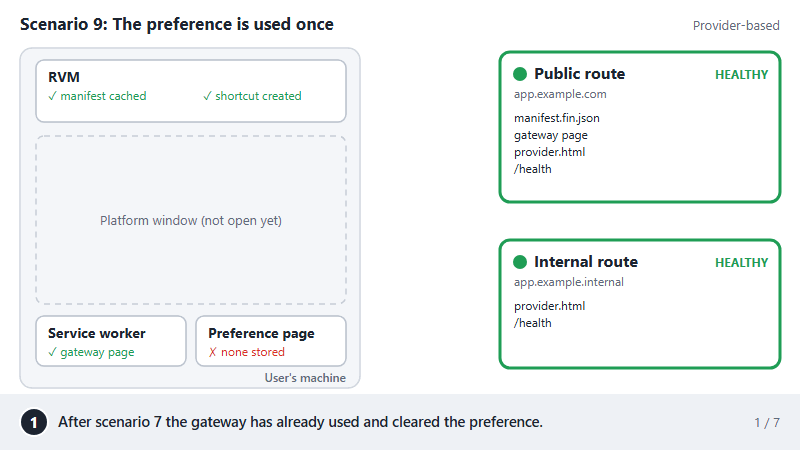

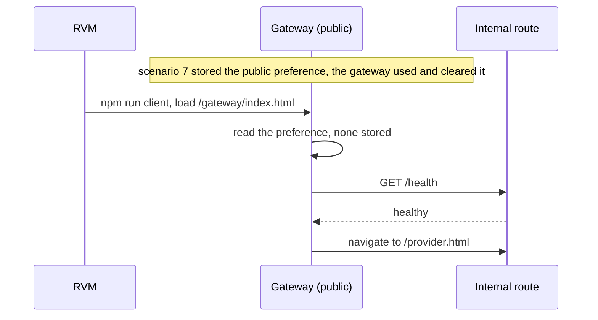

- **Goal:** show that a stored preference applies to one start only.
- **Action:** after scenario 7, run `npm run kill` and `npm run client`.
- **What the user sees:** the platform starts on the internal route again.
- **Observed on Windows:** as expected: `Gateway chose this route by health: app.example.internal is healthy.`

### 10. The preference page rejects other clients

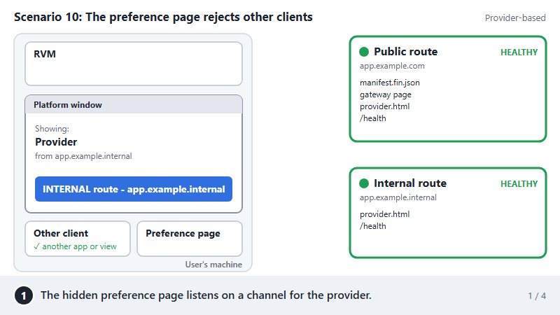

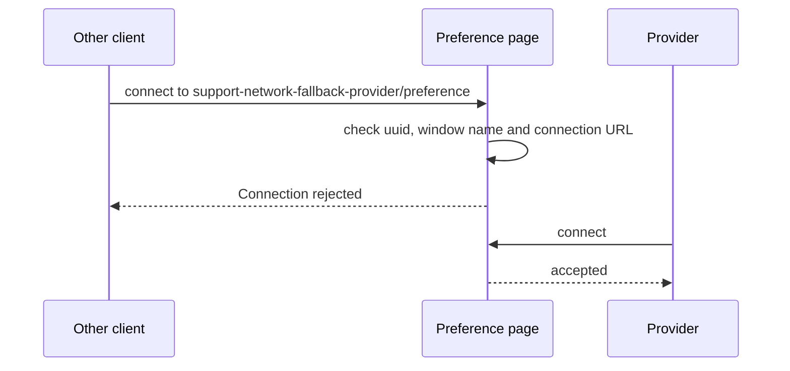

- **Goal:** show that only the platform's provider can store a preference.
- **Action:** this needs a second client, so it is not something you can click. With the preference page open, connect to the `support-network-fallback-provider/preference` channel from any other app, view or external connection.
- **What to expect:** the connection fails with `Connection rejected: ...`, and the page logs `Rejected a connection: ...` with the reason (uuid, window name or connection URL).
- **Observed on Windows:** a node adapter client was rejected with `uuid snf-driver-... is not this platform`.

## Launch params scenarios

The app view's "Launch params" section shows the links, and every set of params that reaches the platform is logged as a highlighted `LAUNCH PARAMS RECEIVED (<source>, <when>): ...` line. See [Deep links, custom scheme and jump list](../README.md#deep-links-custom-scheme-and-jump-list).

### 11. Init params at launch and while running

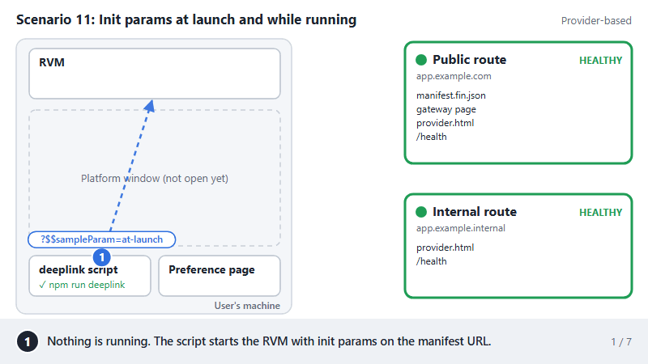

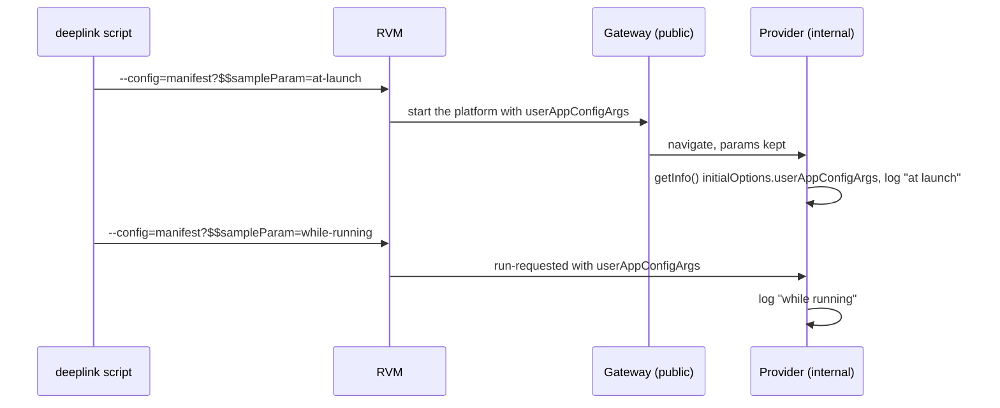

- **Goal:** show that init params reach the provider, through the gateway, whether or not the platform is running.
- **Control panel settings:** both `healthy`.
- **Action:** with nothing running, `npm run deeplink -- init at-launch`. Once the platform is up, `npm run deeplink -- init while-running`, then `npm run deeplink -- fin via-fin-link`.
- **What the user sees:** one platform window. No second platform starts.
- **Log lines to expect:**
  - `LAUNCH PARAMS RECEIVED (init params, at launch): sampleParam=at-launch; launchSource=script`
  - `LAUNCH PARAMS RECEIVED (init params, while running): sampleParam=while-running; launchSource=script`
  - `LAUNCH PARAMS RECEIVED (init params, while running): sampleParam=via-fin-link; launchSource=script`
- **Observed on Windows:** as expected. The params were in `initialOptions.userAppConfigArgs` after the gateway had navigated to the internal provider. The `fin://` link to the HTTP manifest, opened through Windows, was delivered too.

### 12. Custom scheme

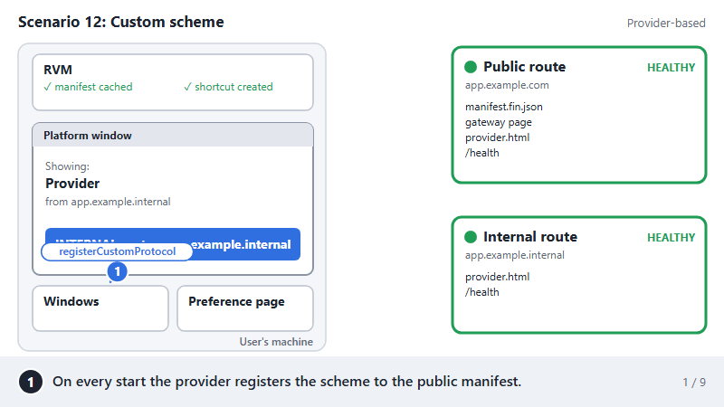

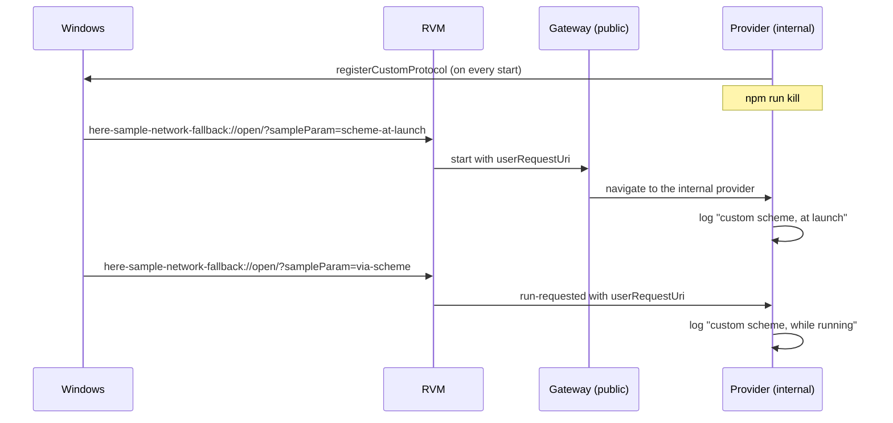

- **Goal:** show the `here-sample-network-fallback` scheme starting the platform and reaching it while it runs.
- **Control panel settings:** both `healthy`.
- **Action:** start the platform once, so the scheme is registered. Run `npm run kill`, then `npm run deeplink -- scheme scheme-at-launch`. Once it is up, `npm run deeplink -- scheme via-scheme`. You can also paste the link from the app view into the Run dialog (Win+R).
- **What the user sees:** the platform starts on the internal route, the route the gateway prefers, even though the scheme is registered to the public manifest.
- **Log lines to expect:**
  - `here-sample-network-fallback:// is registered to http://127.0.0.1:5081/manifest.fin.json.` (or `was ..., now registered to ...` the first time, or after the multi-manifest sample has run)
  - `LAUNCH PARAMS RECEIVED (custom scheme, at launch): sampleParam=scheme-at-launch (from userRequestUri=here-sample-network-fallback://open/?sampleParam=scheme-at-launch)`
  - `LAUNCH PARAMS RECEIVED (custom scheme, while running): sampleParam=via-scheme (...)`
- **Observed on Windows:** as expected. The registry command is `OpenFinRVM.exe "--config=http://127.0.0.1:5081/manifest.fin.json" "--user-request-uri=%1"`.

### 13. Jump list

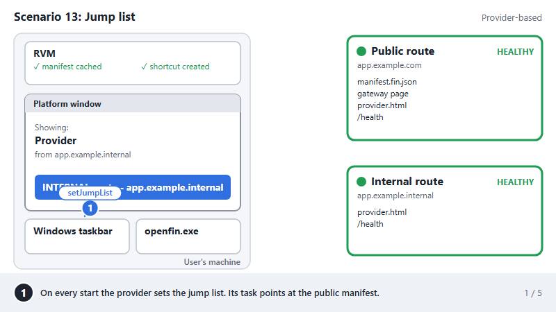

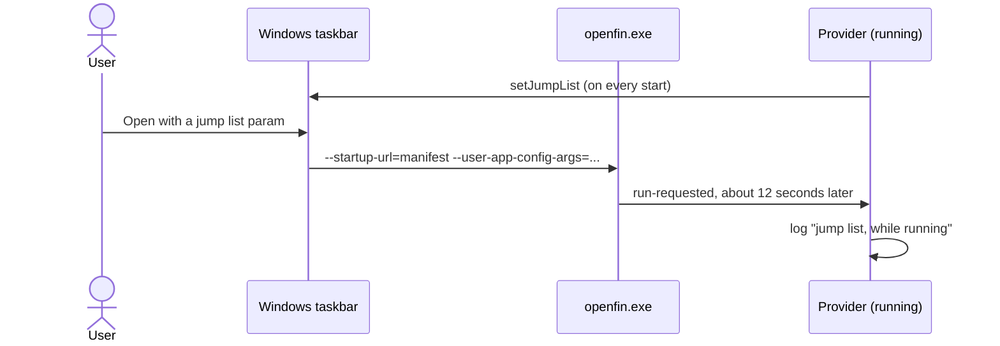

- **Goal:** show the jump list task reaching the platform.
- **Action:** pin the running platform to the taskbar, or right-click its taskbar button, and choose **Open with a jump list param**.
- **Log lines to expect:** `Jump list set; its tasks point at http://127.0.0.1:5081/manifest.fin.json.` at startup, then `LAUNCH PARAMS RECEIVED (jump list, while running): launchSource=jumplist; sampleParam=from-the-jump-list`.
- **What the user sees:** after about 12 seconds, the highlighted launch entry in the log. Wait for it: nothing else shows that the click worked.
- **Observed on Windows:** the task runs `openfin.exe --startup-url=http://127.0.0.1:5081/manifest.fin.json --user-app-config-args=launchSource=jumplist&sampleParam=from-the-jump-list`, without the RVM and the params reached the running platform about 12 seconds later. Clicking the jump list's app entry at the bottom instead ran the RVM with `--config=fin://127.0.0.1:5081/manifest.fin.json` and logged `LAUNCH RECEIVED (while running) with no params`. A task whose `deepLink` was a custom scheme link was rejected with `invalid url`, so the sample has no such task.

### 14. Launch params after a switch

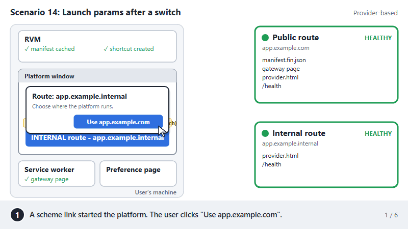

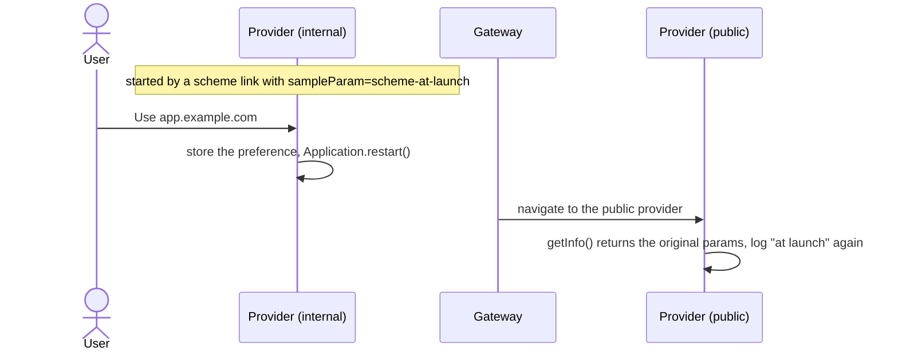

- **Goal:** show what a switch does to the launch params and the scheme.
- **Action:** run scenario 12's first step, then click **Use app.example.com**.
- **What the user sees:** the platform restarts on the public route. The scheme and jump list still point at the same public manifest.
- **Log lines to expect:** after the restart, `LAUNCH PARAMS RECEIVED (custom scheme, at launch): sampleParam=scheme-at-launch ...` again.
- **Observed on Windows:** `Application.restart()` delivered the original launch params again. An app that acts on a param must remember that it has handled it.
